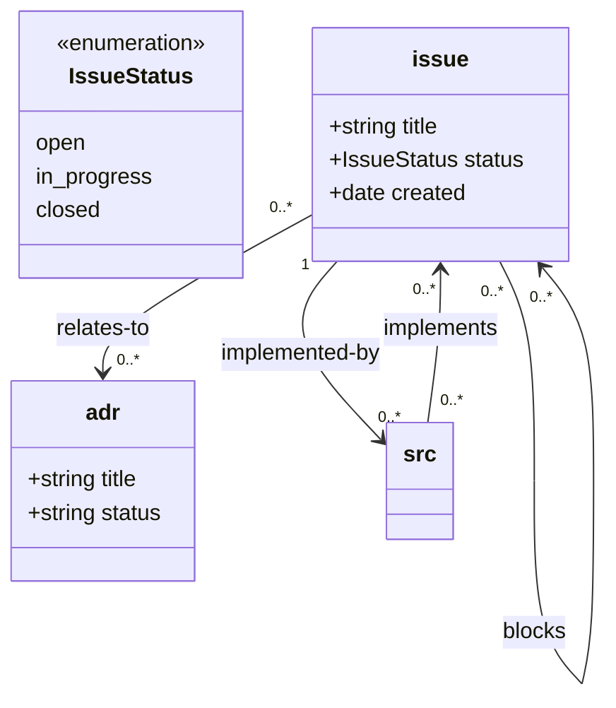

# loom

**Loom** is a markdown document-oriented workflow framework designed for coding agents and developer teams.

Loom turns an ordinary repository of Markdown files into a typed, validated, and queryable graph of instances governed by a Mermaid class diagram (`document-model.mmd`). It enables agents and humans to manage architectures, ADRs, RFCs, issues, requirements, and test plans with mathematical rigor: schema-validated frontmatter, deterministic multi-file atomic changesets, bidirectional code-to-document linkage via Tree-Sitter AST inspection, relational SQL queries through an embedded DuckDB projection, and human-navigable Markdown link generation.

---

## Key Highlights

- **Markdown-Native Source of Truth**: Files remain clean Markdown with YAML frontmatter. Human-readable in GitHub, Obsidian, or VS Code.
- **Agent-Ready Typing & Invariants**: Enforces attributes, required fields, enumerations, inheritance, and edge cardinalities (`1`, `0..1`, `0..*`, `1..*`) defined in standard Mermaid diagrams.
- **Atomic Multi-File Changesets**: Validate the entire graph in memory before writing a single byte to disk. Roll back completely on errors.
- **Deep Source Code Linkage**: Bidirectional links between Markdown documents and code declarations (`src://path/file.ts#Class.method`). Automatically writes reverse-link comments directly into function/class bodies and detects renames across git commits.
- **Embedded DuckDB SQL Engine**: Projects document attributes into native DuckDB tables and edges into an RDF-style triple store (`edge(subject, relation, object)`). Run arbitrary analytical SQL queries across your documentation.
- **Human Navigation & Indexes**: Automatically generates relative Markdown links and backlinks inside protected comments (`<!-- loom:links start -->...<!-- loom:links end -->`). Generate filtered index dashboards or SQL-driven views on demand.
- **Built-in Agent Skills**: Ships with agent skills (`using-loom-cli`, `creating-a-loom-workflow`) so AI coding agents can immediately discover, operate, and extend loom workflows.

---

## Installation & Setup

> **Note**: Loom is currently installed via local checkout. It will be published to npm as `loom-cli` in the future.

### 1. Prerequisites
- Node.js >= 22

### 2. Clone and Link Globally
```bash
git clone https://github.com/your-org/loom-cli.git # or local checkout
cd loom-cli
npm install
npm run build
npm link
```

Verify installation:
```bash
loom --help
```

### 3. Grammar Prefetch
Loom bundles Tree-Sitter parsers for multi-language AST inspection (TypeScript, Python, R, Mermaid). For offline or isolated environments, warm the parser cache:
```bash
loom prefetch
```

---

## Quickstart

### 1. Define Your Model (`design/document-model.mmd`)
Loom uses a Mermaid class diagram to declare document classes, attributes, and allowed relations:



Loom requires zero configuration files: it finds `document-model.mmd` automatically inside the git repository. Document classes without explicit roots resolve under the model's directory (here `design/issue` and `design/adr`). Custom paths can be declared via `%% @path <class> <path>` in the model.

### 2. Validate the Graph
```bash
loom validate
```

If any protected link blocks or non-canonical URIs are found, let Loom heal them automatically:
```bash
loom validate --fix
```

---

## CLI Reference

Global options (`--json`, `--cwd <path>`) must precede the subcommand:
```bash
loom --json <command> ...
```

### Navigation & Discovery
- `loom ls <uri>`: Hierarchical listing of classes, files, or linkable symbols in code.
  ```bash
  loom ls issue://                       # List all issue documents
  loom ls src://src/                     # List source files
  loom ls src://src/auth.ts              # List functions, methods, classes in auth.ts
  ```
- `loom resolve <uri>`: Resolve any document URI to disk path, or source anchor to line number.
- `loom show <uri>`: Display frontmatter and markdown body of an instance.
- `loom locate src://path --line <n>`: Find which AST declaration encloses line `<n>`.
- `loom refs src://path#symbol`: Find which documents reference a code symbol.
- `loom similar "<query>" [--limit n]`: Fast semantic similarity search across documentation bodies.

### Document & Link Mutation
- `loom create <uri> "key: val" ...`: Create a new document instance.
- `loom set <uri> <key> <val>`: Update frontmatter attributes.
- `loom link <from> <rel> <to>`: Link documents together, or link code to a document.
  ```bash
  loom link issue://a.md blocks issue://b.md
  # Inserts a comment directly inside the body of the function:
  loom link src://src/auth.ts#login implements issue://a.md
  # Target from line number:
  loom link src://src/auth.ts --line 42 implements issue://a.md
  ```
- `loom unlink <from> <rel> <to>`: Remove links (and cleanly removes source comments).
- `loom rename <from> <to>`: Rename an instance and automatically rewrite all inbound links across the entire corpus.
- `loom apply <changeset.yaml> [--dry-run]`: Execute an atomic multi-operation batch.

### SQL Queries & Indexes
- `loom rebuild`: Rebuild the embedded `.loom.duckdb` projection.
- `loom query "<sql>"`: Run arbitrary SQL over document tables or the edge triple store.
  ```bash
  loom query "SELECT uri, title FROM issue WHERE status = 'open'"
  loom query "SELECT subject, object FROM edge WHERE relation = 'blocks'"
  ```
- `loom index [--check]`: Regenerate all Markdown index views (`class: index`). `--check` exits with non-zero in CI if indexes are out of date.

---

## Agent Skills

Loom includes dedicated Agent Skills under `skills/`:

1. **`skills/using-loom-cli`**:
   Comprehensive operational manual for an agent working in a Loom-governed repository. Explains command invocations, JSON output contracts, changeset construction, AST annotation rules, and diagnostic troubleshooting.

2. **`skills/creating-a-loom-workflow`**:
   A meta-skill that walks an agent through creating a custom, domain-specific Loom architecture: designing the Mermaid model, configuring index views, formalizing state transition rules, and generating project-tailored workflow skills.

To enable these in an agent harness (such as Pi or OpenCode), copy or link the skill directories into your agent's skill path.

---

## License

MIT
