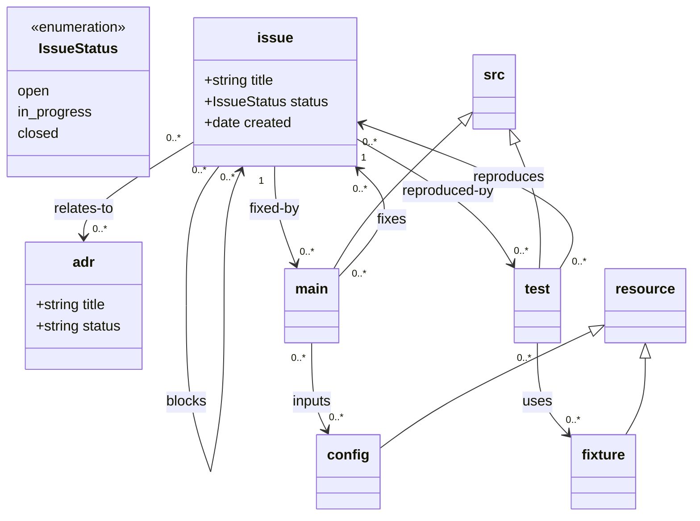

## More complex use of `src` and `resource`

This example demonstrates advanced path handling and zero-configuration discovery in Loom.

### 1. Mermaid UML model with path annotations



In this example, the model file is saved at `$REPO_ROOT/docs/document-model.mmd`.

---

### 2. Zero configuration & model discovery

Loom operates without a `.loom.yaml` configuration file by discovering its model from the git repository.

- **`$REPO_ROOT`**: Defined strictly as the git project root. Loom must be invoked inside a git repository.
- **Model discovery**: The repository is searched for `document-model.mmd` (ignoring `.git` and git-ignored directories).
  - Exactly one match establishes `$LOOM_DEFAULT_ROOT` as the parent directory of that file (here: `docs`).
  - Multiple matches result in an error; the ambiguity must be resolved by setting the `LOOM_DEFAULT_ROOT` environment variable.
  - Zero matches results in a diagnostic error indicating no document model was found.
- **`LOOM_DEFAULT_ROOT` env var**: If set (as a path relative to `$REPO_ROOT`), Loom reads the model directly at `$REPO_ROOT/$LOOM_DEFAULT_ROOT/document-model.mmd` without scanning.
- **Grammars & parsing**: Tree-sitter grammars download lazily on first use for any language encountered in source trees.

---

### 3. Root anchors (`src`, `resource`, `docs`)

Loom defines three terminal root anchors from which all paths originate:

1. **`$LOOM_DEFAULT_ROOT`**: Defaults to the directory containing `document-model.mmd` (or `$LOOM_DEFAULT_ROOT` env var).
2. **`$LOOM_DEFAULT_SRC_ROOT`**:
   - Specified via `%% @path src <path>` in the model.
   - Otherwise via `LOOM_DEFAULT_SRC_ROOT` env var.
   - Defaults to `src` (resolving to `$REPO_ROOT/src`).
3. **`$LOOM_DEFAULT_RESOURCE_ROOT`**:
   - Specified via `%% @path resource <path>` in the model.
   - Otherwise via `LOOM_DEFAULT_RESOURCE_ROOT` env var.
   - Defaults to `resource` (resolving to `$REPO_ROOT/resource`).

In this example:
- `%% @path resource data` sets `$LOOM_DEFAULT_RESOURCE_ROOT` to `$REPO_ROOT/data`.
- `src` is unannotated, so `$LOOM_DEFAULT_SRC_ROOT` defaults to `$REPO_ROOT/src`.
- `$LOOM_DEFAULT_ROOT` is discovered as `$REPO_ROOT/docs`.

---

### 4. Expected URI to path resolution

For this example:

```
issue://    -> $REPO_ROOT/docs/issue
adr://      -> $REPO_ROOT/architecture/design-records
src://      -> $REPO_ROOT/src
main://     -> $REPO_ROOT/src/main
test://     -> $REPO_ROOT/src/test
resource:// -> $REPO_ROOT/data
fixture://  -> $REPO_ROOT/data/test-fixtures
config://   -> $REPO_ROOT/input
```

---

### 5. Path resolution rules & heuristics

Every class in the model resolves to a single unique path from `$REPO_ROOT`:

1. **Explicit annotation**:
   - Declared as top-level `%% @path <class> <path>` comment directives in `document-model.mmd`.
   - **Absolute path** (begins with `/`): Resolved directly relative to `$REPO_ROOT`.
     - Example: `%% @path config /input` resolves to `$REPO_ROOT/input`.
     - Example: `%% @path adr /architecture/design-records` resolves to `$REPO_ROOT/architecture/design-records`.
   - **Relative path** (does not begin with `/`):
     - For classes inheriting from a UML parent: resolved relative to the resolved path of their UML parent.
     - For document classes without a UML parent: resolved relative to `$LOOM_DEFAULT_ROOT`.
     - For the terminal anchors `src` and `resource`: relative paths resolve relative to `$REPO_ROOT` (e.g. `%% @path resource data` -> `$REPO_ROOT/data`).
2. **Default (absent `%% @path`)**:
   - The relative path defaults to the class name itself (`<class>`).
   - If the class has a UML parent, it resolves under that parent's path (e.g. `src <|-- main` without `@path` resolves to `src/main`).
   - If the class has no UML parent, it resolves under `$LOOM_DEFAULT_ROOT` (e.g. `issue` without `@path` resolves to `docs/issue`).
3. **Inferred classes**:
   - Any class participating in an inheritance or relation statement is a valid class in the model even if omitted from explicit `class <name>` blocks (e.g. `main` and `test` in `src <|-- main`).
4. **Collision rule**:
   - If two distinct concrete classes resolve to the exact same repository path, Loom raises a validation error.
   - Distinct classes may nest directories inside one another (e.g. `src/main` inside `src`), which is permitted.
5. **Repo boundary & existence checks**:
   - It is a validation error if any resolved path escapes `$REPO_ROOT` (e.g. using `..`).
   - Loom emits a warning during validation if a resolved class directory does not exist on disk, helping users and agents catch path typos early.
6. **Path-to-URI canonicalisation**:
   - Paths resolve to the most specific matching class URI scheme (longest matching root prefix wins).
   - If a path matches no class root, it falls back to `repo://relative/path`.
