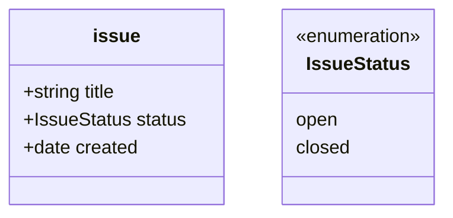

# Implementation plan

Implementation plan for the tool described in [scope.md](./scope.md). Read that
first; this document does not restate the requirements, it says how and in what
order they get built. For the command surface see
[cli-interface.md](./cli-interface.md); for how source code is addressed and
annotated, [source-linkage.md](./source-linkage.md).

## 1. Guiding decisions

These are settled and should not be relitigated without updating this section.

### 1.1 Files are the source of truth

The YAML header of each class instance is the single source of truth. Everything
else is a **projection** that must be reproducible from a cold start by deleting
it and running `design-docs rebuild`:

| Artefact | Derived from | Committed |
|---|---|---|
| Protected markdown link block | YAML relations | yes (so plain markdown tools can navigate) |
| DuckDB attribute tables | YAML attributes | no (git-ignored) |
| DuckDB triple store | YAML relations | no (git-ignored) |
| Navigational indexes | DuckDB query in index frontmatter | yes |
| Embeddings | unprotected markdown body | no (git-ignored) |
| Validation report | whole-graph validation | yes |

Consequences: the database never needs migrations, corruption is fixed by
rebuilding, and anomaly correction (scope §CLI.7) always has an unambiguous
direction to push.

### 1.2 "Transaction" means validate-then-write, not a database transaction

A changeset is parsed, applied to an in-memory graph, and the **whole resulting
graph** is validated. Only if validation passes are files written, each via
write-to-temp + atomic rename. There is no rollback journal and no partial
write. Git is the undo mechanism.

### 1.3 Runtime and dependencies

- **Node 22+, TypeScript, ESM.** Node 22 is the floor imposed by the language pack.
- `@xberg-io/tree-sitter-language-pack` — 372 pre-compiled grammars, NAPI
  binaries for linux/mac/windows on x64 and arm64. Supplies both mermaid and all
  target source languages including R.
- `@duckdb/node-api` (the "Neo" bindings; the older `duckdb` package is deprecated).
- `yaml` (eemeli) using the **Document API**, not `JSON.parse`-style loading, so
  hand-written comments and key order in frontmatter survive a round-trip.
- `commander` for the CLI.
- Tests: built-in `node:test` + `node:assert`. No test framework dependency.

Explicitly **not** taken on: no markdown AST library (protected regions are
delimited by HTML comments and spliced textually), no schema library such as zod
(validation is written directly against the model IR so errors can cite the
model), no vector index (brute-force cosine over a few thousand documents is
instant).

### 1.4 Agent-first interface

The primary consumer is a coding agent driving the CLI, with an MCP wrapper
later. Therefore, from Phase 0:

- **YAML in, YAML out.** Storage is YAML and changesets are YAML, so structured
  output is YAML too — one syntax for the whole tool, and `show` output can be
  pasted straight into a changeset. Input accepts JSON as well, for free, since
  YAML is a superset of JSON. `--json` flips the output format for pipelines
  that want `jq`; it is a serialisation switch over the same data structure, not
  a second code path.
- Diagnostics are records: `{ severity, code, uri, line?, message, fix? }`.
- Exit codes: `0` ok, `1` validation failures found, `2` usage/internal error.
- Commands are idempotent — running `index` or `rebuild` twice is a no-op.

**JSON Schema is not used.** Validation is against the document model, which a
JSON Schema cannot express anyway — cardinality spanning files, URI resolution,
covariant endpoints. The only other structured inputs are the changeset and the
config, both small and fixed, where hand-written checks give better messages.
Same reasoning as the exclusion of zod in §1.3.

### 1.5 Class roots come from config, not from mermaid

Scope §IA.4 requires each class to declare its root path. Mermaid has no natural
syntax for this, and stretching it (notes, fake attributes) makes the model file
worse. Instead: the default root is `$DESIGN_DOCS_ROOT/<class>`, overridden in
config. Mermaid is used only for what it expresses natively — classes,
attributes, types, relationships, cardinalities, and the `<<enumeration>>` and
`<<abstract>>` annotations.

A class may declare **more than one** root. This is what makes the `src` family
work (§1.9): a `test` class extending `src` points at `tests/` while `src`
itself points at `src/`. Abstract classes (§1.8) have no root at all, since they
have no instances.

### 1.6 Relations are per-relation keys in the YAML

```yaml
blocks: [issue://other-thing.md]
implemented-by: [src://r/model.R#fit_model]
```

rather than a generic `links:` list. It reads better, projects directly into the
triple store, and the model already defines the relation names. The cost is that
attribute names and relation names share a namespace — so "a class must not
declare an attribute and a relation with the same name" becomes a model
validation rule in Phase 1, and it must account for inherited names too (§1.8).

**Each edge is stored exactly once, on the source side.** The model declares a
direction, and only the source document carries the key. There are no inverse
relation names to declare and no two-ended write to keep consistent. Navigation
in the other direction is served by a **Backlinks** section in the generated
protected block (§2.2), labelled with the forward relation name, and by the
triple store. This is §1.1 applied to edges: one place to write, everything else
projected.

**Cardinality reads UML-style: the multiplicity next to a class says how many of
that class participate per instance of the other.** This inverts easily and
silently, so the worked example is normative:

```mermaid
issue "1" --> "0..*" src : implemented-by
```

— each `issue` is implemented-by zero or more `src`, and each `src` is
implemented-by exactly one `issue`.

### 1.7 Attribute type vocabulary

Primitives: `string`, `int`, `float`, `bool`, `date`, `path`, `uri`. A list of
any of these uses mermaid's **generic** syntax, `+List~string~ tags` — the
array form `+string[] tags` produces a parse error in the mermaid grammar and
must not be used. Attributes are **required by default**; a trailing `?` on the
name marks one optional (`+string assignee?`). An attribute may also be typed by
an `<<enumeration>>` class, whose permitted values are its member list —
enumerations are part of the first model release, not a later addition. That is
the entire vocabulary; no further primitives are anticipated.

An `<<enumeration>>` class is a **type, not a document class**: like
`<<abstract>>` (§1.8) it has no class root, no URI scheme, no instance files and
no DuckDB table. An enum is referenced only by naming it as an attribute's type;
never by an arrow, which always means an edge. Convention: instantiable classes
are lower-case, since the name becomes a directory and a URI scheme
(`issue` → `design/issue/`, `issue://`), while enumerations and abstract types
are PascalCase. That is cosmetic, not enforced.

`path` and `uri` differ only in how they validate: a `path` must resolve to an
existing file in the repository, a `uri` must be a well-formed and resolvable
design URI (§2.4). Neither creates an edge — a `uri` attribute is a scalar that
happens to point somewhere, whereas a relation is modelled, cardinality-checked
and projected into the triple store. If a link matters to the graph, model it as
a relation, not as a `uri` attribute.

A minimal but complete model, and the instance it validates:



```yaml
---
class: issue
id: my-first-issue.md
title: The thing is broken
status: open
created: 2026-10-21
---
```

### 1.8 Inheritance and abstract classes

Standard class inheritance. A subclass inherits its parent's attributes and
relations, and relation endpoints are **covariant**: a relation declared against
`issue` accepts any subclass of `issue` at that end.

A class annotated `<<abstract>>` is not instantiable. It contributes attributes
and relations to its subclasses but has no class root, no files, no URI scheme
and no DuckDB table. An instance file declaring an abstract class is a
validation error.

`<<abstract>>` has two uses, told apart by how the model consumes the class and
not by any extra syntax: as a **supertype** via `<|--`, and as the type of a
**class-typed attribute** (§1.10). A class may be both.

### 1.9 `src` is a class family, not a single class

Scope §IA.9 allows `src` to be extended in the document model. The motivating
case: a `test` class extending `src`, with its own root and its own permitted
relations, so that "this test exercises that requirement" is a distinct,
separately-validated edge from "this function implements that issue".

Each `src` subclass therefore gets its own URI scheme (`test://a/b.R`) and its
own root list, and inherits the family constraints: no structured YAML, deep
links to symbols rather than whole files, and reverse linkage only through
source comments.

When two roots in the family both contain the same relative path, **first match
wins** — in the order roots are listed in config — and the ambiguity is raised
as a validation warning naming both candidates, so an agent can disambiguate it
rather than silently getting the wrong one.

### 1.10 Nested values are attribute types, not composition edges

One rule covers every non-document construct: **an arrow is always an edge; a
type named in member text is always by value.** An `<<enumeration>>`-typed
attribute embeds a scalar (§1.7); a class-typed attribute embeds a nested YAML
block.

```mermaid
class issue {
    +string title
    +Contact reporter
    +List~Contact~ reviewers
}

class Contact {
    <<abstract>>
    +string name
    +string email?
}
```

```yaml
reporter:
  name: Ada
  email: ada@example.org
reviewers:
  - name: Grace
```

UML's composition and aggregation arrows (`*--`, `o--`) are **not** used for
this and are rejected by the model validator with a diagnostic pointing at the
attribute-type form. Quietly accepting them as a synonym would let a corpus grow
with two spellings for one idea.

A value type is just a non-instantiable class (§1.8) used as an attribute type
rather than as a supertype. No new annotation is needed — which of the two a
class is, or whether it is both, is derived from how the model uses it.

Two constraints follow, both checked in Phase 1:

- A class used as an **attribute type** must declare attributes only, **no
  relations**. An embedded value has no URI, so an edge leaving it would have an
  unaddressable subject, and "every triple-store subject is URI-addressable" is
  load-bearing for Phases 4 and 5. Hang the edge off the owning document
  instead. A class used only as a *supertype* has no such restriction, since its
  subclasses are real documents with URIs.
- Value-type containment must be acyclic.

None of this is built in Phases 0–7. What matters now is that the syntax is
settled, so the Phase 1 IR carries an attribute type as a tagged union rather
than a bare string, and no corpus accumulates composition arrows that later need
rewriting. See "Later — composite attributes".

## 2. Concrete formats

These are the user-facing contracts. They are fixed early because every later
phase depends on them.

### 2.1 Config — `$REPO_ROOT/.design-docs.yaml` (optional)

```yaml
designRoot: design          # default: design
classRoots:                 # default: <designRoot>/<class>
  issue: design/issues
  src:  [src, R]            # a class may list several roots; first match wins
  test: [tests, testthat]   # src subclass with its own roots (§1.9)
languages: [r, typescript, python]   # grammars to prefetch (§Phase 5)
```

`classRoots` is uniform: `src`-family classes are configured the same way as
document classes, they simply tend to have several roots and live outside
`designRoot`. Abstract classes must not appear here.

Repo root is the git root unless the file is found elsewhere. Absent config is
valid and means all defaults.

### 2.2 Class instance file

```markdown
---
class: issue
id: my-first-issue.md
title: The thing is broken
status: open
blocks: [issue://other-thing.md]
---

<!-- design-docs:links start -->
- blocks: [The other thing](../issues/other-thing.md)
<!-- design-docs:links end -->

Free prose, edited by anything, never touched by the tool.
```

`class` and `id` are written for self-description and cross-checked against the
file's location; the location wins on conflict (§1.1).

The generated block carries outbound links and, below them, inbound ones:

```markdown
<!-- design-docs:links start -->
- blocks: [The other thing](../issues/other-thing.md)

### Backlinks
- blocks: [Something upstream](../issues/upstream.md)
<!-- design-docs:links end -->
```

**Link text** comes from the target's `title` attribute, falling back to its
instance-id when absent. `title` is therefore a reserved attribute name with a
fixed meaning: any class that can be the target of a relation should declare
one, and the model validator warns when it does not.

**Generated content is deterministically ordered** — by relation name, then by
canonical target URI — so regeneration never produces diff churn.

**YAML writer rules.** The emitter must quote any scalar that YAML 1.1 would
coerce, because these files are read by other tooling, much of which is still
YAML 1.1: `no`, `yes`, `on`, `off`, `y`, `n` and their capitalisations become
booleans; `0755` becomes octal; `12:30` becomes sexagesimal. Note that the
`yaml` package's default `stringify` does **not** quote these — it must be
configured to. Separately, and in *both* YAML versions, an unquoted `1.10`
parses as the number `1.1`, silently losing data from a string attribute. Phase
0 owns a single `writeScalar` that applies these rules, and a test asserting
that a document containing every trap round-trips identically under both a
YAML 1.1 and a YAML 1.2 reader.

### 2.3 Changeset

```yaml
ops:
  - { op: create, uri: "issue://new.md", attrs: { title: "…", status: open } }
  - { op: set,    uri: "issue://new.md", attrs: { status: closed } }
  - { op: link,   from: "issue://a.md", rel: blocks, to: "issue://b.md" }
  - { op: unlink, from: "issue://a.md", rel: blocks, to: "issue://b.md" }
  - { op: rename, from: "issue://a.md", to: "issue://archive/a.md" }
  - { op: delete, uri: "issue://a.md" }
```

### 2.4 URI canonicalisation

Canonical internal form is the repo-relative POSIX path. Stored/display form is
the most compact scheme: if the path lies under exactly one class root, the
class scheme; if under several (nested roots), the **longest matching** root;
else `design://`; else `repo://`. This rule is total and deterministic, which is
what makes equivalence testing (scope §IA.13) cheap.

`src`-family roots participate in exactly the same rule, so a file under the
`test` root canonicalises to `test://` rather than `src://` without any special
casing. The one addition is §1.9's ambiguity warning, which fires when a path
matches roots of two *different* classes in the family.

## 3. Phases

Each phase ends with a working CLI and its own tests. Phase 2 is the MVP — the
first point at which the tool is worth running on a real repository.

### Phase 0 — Foundations

**Scope.** Config discovery and defaults. URI parsing, resolution,
canonicalisation and equivalence. Reading and writing a class instance file as
`{ frontmatter, protectedBlock, body }` with comment-preserving YAML. Protected
region splice that is a byte-for-byte no-op when content is unchanged.
Diagnostic type, the `writeScalar` rules of §2.2, and output serialisation
(YAML default, `--json` switch).

**Commands.** `design-docs resolve <uri>`, `design-docs show <uri>`.

**Done when.** A property test round-trips a corpus of awkward files (CRLF, no
trailing newline, unicode, YAML anchors, absent protected block, protected block
in an unexpected position, and every coercion trap from §2.2) under this rule:
the first write may **normalise** — the `yaml` Document API collapses whitespace
before a trailing comment, so byte-exact preservation is not achievable — but it
must not change any value or lose any comment, and **every subsequent write must
be byte-identical**. Idempotence after one normalising pass, not byte-exactness
on the first.

**Risk.** Low. This is the only phase with no external unknowns, which is why it
goes first.

### Phase 1 — The document model

**Scope.** Parse `$DESIGN_DOCS_ROOT/document-model.mmd` via the pack's mermaid
grammar into a schema IR: classes, attributes (name, type per §1.7, required),
relations (name, source, target, cardinality both ends), inheritance with
covariant endpoints and `<<abstract>>` (§1.8), `<<enumeration>>` classes and
their member lists, `src` subclassing (§1.9), and the reserved `src` /
`resource` families with their "no structured YAML" constraint. Attribute types
are a tagged union in the IR from day one (§1.10). Validate the model itself:
unknown types, duplicate names, attribute/relation collision including inherited
names (§1.6), structured YAML declared on a reserved class, an abstract class
given a root, an enumeration with no members, an inheritance cycle, a
composition or aggregation arrow (§1.10), a class used as an attribute type that
declares relations, and a cycle in value-type containment. Validate one instance
against the IR.

**Commands.** `design-docs model check [--model <path>]`,
`design-docs validate <uri>`.

**Why tree-sitter and not mermaid's own parser.** `@mermaid-js/parser` (the
Langium rewrite, 2.0.1) covers `info`, `packet`, `pie`, `treeView`,
`architecture`, `gitGraph`, `eventmodeling`, `radar`, `railroad*`, `treemap`,
`wardley` and `cynefin` — **not `classDiagram`**, which is still served by the
legacy jison parser inside the `mermaid` package. Using that means deep-importing
a private path and reading parse results out of a stateful module-level
`classDb`, in a browser-oriented package. Rejected. Re-evaluate if upstream
migrates class diagrams to Langium: keep the parser behind a
`parseModel(text) -> SchemaIR` interface so that swap stays a one-file change.

**Conformance.** tree-sitter-mermaid accepting a model file does not prove
mermaid itself will render it, and a model file that does not render is a real
defect. Guard this with a dev-dependency-only test that runs the fixture models
through mermaid's own parser. It never ships in the runtime dependency tree.

**Spike: done.** A model exercising `<<abstract>>`, `<<enumeration>>`,
inheritance (`<|--`), cardinality on both ends and a relation label parses with
`hasError() == false`, and every construct is recoverable with a line number.
Three findings fix the design:

1. The grammar gives **statement-level structure only**. An attribute arrives as
   one `class_method_line` node whose text is verbatim (`"+IssueStatus status"`)
   — visibility, type and name are *not* separate CST nodes. Phase 1 is
   therefore a hybrid: tree-sitter for which class, which members, which
   relations, which cardinalities and which annotations; a single regex for the
   member line. This is the only hand-written parsing in the tool, and it
   replaces the fallback line-based parser that was previously budgeted for.
2. Enum members arrive as `class_method_line` too, identically to attributes.
   They are distinguished by the **owning class's annotation**, not by node
   kind — so the parser must read annotations before members.
3. `+getTitle()` is likewise a `class_method_line`; methods are ignored per the
   ADR, detected by the trailing `()` in the same regex.

**Residual spike work.** Confirm that a malformed member line localises to a
usable line number rather than poisoning the whole `class_stmt_class` node, so
diagnostics can cite the offending attribute rather than the whole class.

**Done when.** The documented mermaid subset is written down in this repo as a
reference, every construct in it — including `<<abstract>>`, `<<enumeration>>`,
inheritance and `src` subclassing — has a parse test, every fixture model passes
the mermaid conformance test, and a deliberately broken model produces a
diagnostic citing the offending line.

**Risk.** Low-medium, reduced by the spike above having already landed. What is
left is the breadth of the mermaid subset, not whether the approach works.

### Phase 2 — Whole-graph validation (MVP)

**Scope.** Walk all class roots, load every instance, build the graph in memory.
Check: attribute types and requiredness, enum values against their member list,
`path` attributes resolving to real files, relation endpoint classes under
covariant subtyping, relation cardinality at both ends, dangling URIs,
`resource` targets that do not exist on disk, orphaned files under a class root,
instances declaring an abstract class, and instances whose declared `class`/`id`
disagree with their location. Emit the report to
`$DESIGN_DOCS_ROOT/VALIDATION.md` and to stdout. Model-change impact analysis
(scope §CLI.9) is the same code path run against a proposed model file.

**Commands.** `design-docs validate [--model <proposed.mmd>] [--fix]`.

`--fix` handles only the unambiguous repairs: regenerate a stale or missing
protected link block from the YAML, normalise a non-canonical URI. Anything
needing a judgement call is reported, not fixed.

**Done when.** A fixture repository with one seeded instance of each failure
class produces exactly the expected diagnostic set, and a clean repository exits
0 with an empty report.

**Risk.** Low. Mostly bookkeeping over Phase 1's IR.

### Phase 3 — Mutation

**Scope.** Changeset parsing, in-memory application, whole-graph validation,
atomic multi-file write (§1.2). Protected link block regeneration with correct
relative paths. `rename` rewrites every inbound URI across the corpus — this is
the operation that makes path-as-identity survivable, and `git mv` without it is
the single most likely way a user corrupts their graph.

**Commands.** `design-docs apply <changeset.yaml> [--dry-run]`,
`design-docs rename <from-uri> <to-uri>`, plus thin sugar for single ops
(`create`, `set`, `link`, `unlink`, `delete`) that build a one-op changeset.

**Done when.** `--dry-run` prints the exact diff that `apply` would write; a
changeset that fails validation leaves the working tree byte-identical; a rename
with N inbound links updates exactly N files plus the moved file; backlink
sections update on both ends of every changed edge; and applying the same
changeset twice is a no-op.

**Risk.** Low-medium. The failure mode to test hardest is a partial write after
a mid-sequence error.

### Phase 4 — DuckDB projection

**Scope.** Project the graph into `$DESIGN_DOCS_ROOT/.design-docs.duckdb`
(git-ignored): one table per concrete class with its scalar attributes, plus
`edge(subject, relation, object)`. Attribute types map to native DuckDB types
(`date` → `DATE`, `int` → `INTEGER`, enums → `VARCHAR`, with the member list
enforced at validation rather than by a DB constraint) so that comparisons and
aggregates need no casts. Class-typed attributes will project as `STRUCT` when
they arrive — see "Later — composite attributes". Abstract classes get no table
(§1.8);
`src`-family and `resource` instances get no table either, since they have no
structured YAML — they appear only as subjects or objects in `edge`. Full
rebuild only — incremental update is not worth the invalidation bugs at this
corpus size. Pass arbitrary SQL through to DuckDB.

**Commands.** `design-docs rebuild`, `design-docs query "<sql>" [--json]`.

**Done when.** A rebuild of a fixture repo produces the expected schema and row
counts, and `rebuild` from scratch and `rebuild` over an existing database give
identical databases.

**Risk.** Low.

### Phase 5 — Source code linkage

> Phase 5 shipped the resolution and scanning described here.
> [source-linkage.md](./source-linkage.md) supersedes it: it settles the
> anchor-kind policy, makes anchor ambiguity a hard error, adds overload
> qualification, and replaces the attribution heuristic below with body-span
> containment. That last point is a behaviour change, not a refinement.

**Scope.** Resolve `src://path/File.ext#symbol` — and the equivalent URI of any
`src` subclass such as `test://` (§1.9) — to a line number using `process()`
with `structure: true`, searching the nested `StructureItem` tree so
`#Class.method` works. Resolution walks that class's configured roots in order,
first match winning, and emits the ambiguity warning when a later root also
matches. Scan source files for reverse-link comments (`// rel: issue://x.md`),
and attribute each to its enclosing definition by testing the comment's span
against `StructureItem` spans. Fold both directions into Phase 2's validation: a
`src://` URI naming a symbol that no longer exists is a diagnostic, as is a
reverse-link comment pointing at a missing document, using a relation the model
does not define, or using a relation not permitted for that particular `src`
subclass.

**Commands.** `design-docs resolve <src-uri>` (now returns a line number),
`design-docs refs <src-uri>` (which documents reference this function),
`design-docs prefetch` (download the configured grammars).

**Two things to settle in a spike.** First, `CommentInfo.associatedNode` is
documented as "name of the syntax node this comment is directly associated
with", which is ambiguous between the node *type* and the declared identifier —
do not depend on it; derive enclosure from spans and treat the field as a
cross-check. Second, grammars download on first use, so an offline or sandboxed
run fails unless `prefetch` has been run; the configured language list must be
explicit and `prefetch` must be part of the documented setup.

**Done when.** Fixture source files in R, TypeScript and Python resolve named
functions and methods to correct line numbers, a fixture with a `test` subclass
resolves under its own root and scheme, a path present under two roots produces
exactly one resolution plus one warning, reverse-link comments are attributed to
the right enclosing function, and a renamed function surfaces as a validation
diagnostic.

**Risk.** Medium, but much lower than it first appeared: the structure and
comment extraction is language-agnostic, so there is no per-language query work.
The residual risk is grammar coverage quality for specific languages.

### Phase 6 — Navigational indexes

**Scope.** An index file is an ordinary markdown file whose frontmatter declares
a view (a SQL query or a filter over classes and attributes) and whose body is a
protected generated region of relative wiki links. Regenerating is idempotent.

**Commands.** `design-docs index [--check]`. `--check` exits 1 if any index is
stale, for CI.

**Done when.** A stale index is detected by `--check` and brought up to date by
`index`, and regenerating an up-to-date index changes no bytes.

**Risk.** Low.

### Phase 7 — Semantic search

**Scope.** Embed the unprotected markdown body of each instance, cache vectors
in DuckDB keyed by a content hash so only changed documents are re-embedded,
and answer similarity queries by brute-force cosine. The embedding provider is
an interface with one local implementation; the choice of model is deliberately
deferred to this point.

**Commands.** `design-docs similar <uri|text> [--limit n]`.

**Done when.** Re-running after editing one document re-embeds exactly one
document.

**Risk.** Low, and fully isolated — nothing else depends on this phase.

### Later — composite attributes

Class-typed attributes serialised as nested YAML blocks (§1.10). Phases 0–7
reserve what is needed to add this without a rewrite; the work itself is a
later phase because every earlier one is useful without it.

**A nested value projects as a DuckDB `STRUCT`**, and a list of them as
`STRUCT(...)[]`. Not a JSON column, and not a child table — an embedded value
has no identity to key a child table on (§1.10). Measured differences that
decided it:

| | `STRUCT` | `JSON` |
|---|---|---|
| Subfield access | `reporter.name` | `doc->'reporter'->>'name'` |
| Misspelt field | Binder Error, query fails | silently `NULL` |
| Types | `INT`/`DATE` preserved | `->>` always returns `VARCHAR` |
| `m.priority > 5` | works | binder error without `::INT` |
| `sum(m.priority)` | works | fails without a cast |
| List of values | `UNNEST(reviewers).name` | errors without a `::JSON[]` cast |
| `DESCRIBE` | shows the nested schema | opaque `JSON` column |

The second and last rows carry the most weight for an agent-driven tool: a
misspelt field must fail loudly rather than return an empty result that looks
like a true negative, and `DESCRIBE` must reveal what is queryable without the
agent having to read the mermaid model. A JSON column also sorts dates
lexicographically, which is right for ISO-8601 by luck and wrong the moment any
other format appears.

The structural argument is what makes this safe rather than merely convenient:
the document model fixes each attribute's type, so every row of a given class is
homogeneous by construction, and the one thing JSON is better at — schema that
varies per row — cannot arise. §1.10's acyclicity rule bounds nesting depth,
which is exactly what a statically-typed `STRUCT` requires. Model changes cost
nothing because Phase 4 is a full rebuild (§1.1), so there is no migration to
pay for the rigidity.

### Later — MCP server

A thin wrapper exposing `validate`, `query`, `refs`, `similar` and `apply` as
MCP tools. Deliberately out of scope until the CLI's JSON contract has been
exercised by real use; building it earlier would freeze that contract too soon.

## 4. Cross-cutting concerns

**Testing.** Each phase ships fixture repositories under `test/fixtures/` and
golden-file assertions on the serialised output. The round-trip property tests
from Phase 0 run against every later phase's write path, since "the tool must
never mangle a hand-edited file" is the invariant most likely to regress.

**Performance.** Assume thousands of documents, not millions. Full rescan and
full rebuild everywhere. Revisit only if a real corpus makes it hurt.

**Concurrency is out of scope.** Two agents running `apply` against the same
repository at once can interleave writes. The tool does not lock. This is
acceptable because the working tree is git-backed and the realistic usage is one
agent at a time; if it stops being true, a lockfile around the write phase of
§1.2 is the fix, not a redesign.

**The validation report is a plain generated file, not an `issue` instance.**
Self-hosting the issue tracker on the thing being validated creates a
bootstrapping circularity during exactly the phases when validation is least
trustworthy. Once the tool is stable, generating real `issue` instances from
diagnostics is an easy addition.
