# Inline Views: SQL and filter results in any markdown file

Status: **implemented**.

## 1. Motivation

The current `loom index` mechanism works well for dedicated index files (files
whose frontmatter declares `class: index` and a `view`), but it cannot:

- Show a status table **inside** an issue document (e.g. "all open issues blocking
  this one")
- Show **backlinks** at the bottom of a document ("these issues point to this
  one") without littering the prose with hardcoded lists
- Embed a **live query** result (e.g. a sprint burndown projection)
- Let a markdown author write a declarative marker that pulls in data from
  anywhere in the graph

A single `<!-- loom links -->` block exists already (source-linkage §1.3), but
it is a write-target that loom manages automatically — not something a user
drops into prose to pull in a derived table.

## 2. Proposal

### 2.1 Inline view markers

Any markdown file can contain a marker comment:

```markdown
## Blocking Issues

<!-- loom view: blocking_issues?id=fix-login.md -->

Some more prose below.
```

The `loom render` command (or an enhanced `loom index`) scans every markdown
file under `designRoot`, finds these markers, runs the named view against the
DuckDB graph, and replaces the span between

```markdown
<!-- loom view: blocking_issues?id=fix-login.md -->
<!-- loom view: end -->
```

with the result rendered as a markdown table — or a bullet list when there is
only one column.

Parameters after `?` are passed to the view as named arguments (`id`,
`status`, etc.), so the same view definition can serve many documents.

### 2.2 Where view definitions live

Views are defined in `%% @view` annotations inside the Mermaid model file
(`document-model.mmd`) — the same file that already governs path resolution,
class definitions, and relations. This keeps all structural knowledge in one
place, consistent with the principle that the model is the source of truth.

A view definition looks like:

```mermaid
classDiagram
    %% @view active_issues
    %%   SELECT uri, title, status FROM issue WHERE status = 'open'
    %%   ORDER BY title

    %% @view blocking_issues
    %%   SELECT subject, relation, object
    %%   FROM edge
    %%   WHERE object = $id AND relation = 'blocks'
    %%   ORDER BY subject

    %% @view backlinks
    %%   SELECT subject, relation
    %%   FROM edge
    %%   WHERE object = $id

    class issue {
        ...
    }
```



**Rationale for putting views in the model file, not in DuckDB:**

- **Files are source of truth** — DuckDB is a rebuildable projection. A view
  definition lives in the model and version-controls with it. Blowing away
  `.loom.duckdb` does not lose the view definitions.
- **One place to look** — the model already defines what exists and how it
  relates. The views that surface that data should be co-located.
- **Parameter substitution** — `$id`, `$status` etc. are resolved at render time
  from the marker's query-string parameters. DuckDB's `CREATE VIEW` does not
  support parameterised views without awkward session-level machinery.
- **Familiar editing surface** — `document-model.mmd` is already the file
  authors touch when they change the schema. Adding a view there follows the
  same pattern as `%% @path`.

**Alternative considered — dedicated YAML view file:**

```yaml
# design/views.yaml
active_issues:
  sql: SELECT uri, title, status FROM issue WHERE status = 'open' ORDER BY title
  columns: [uri, title, status]
```

Rejected because it introduces a second configuration format and a new file to
discover, when the model file is already loaded and parsed.

### 2.3 Rendering

`loom render` (name TBD — could be `loom index --inline` or a new subcommand):

1. Parse `%% @view` annotations from the model file (same mechanism as
   `%% @path`).
2. Walk every `.md` file under `designRoot`.
3. For each `<!-- loom view: <name>?<params> -->` marker:
   a. Look up `<name>` in the view definitions. Fail with a diagnostic if
      undefined.
   b. Resolve parameters (`$id` → `fix-login.md`, `$status` → `open`, etc.)
   c. Run the SQL against DuckDB (rebuilding the database first if absent).
   d. Render the result rows as a markdown table.
   e. Replace the range from `<!-- loom view: ... -->` to
      `<!-- loom view: end -->` (or insert the end marker if it does not exist)
      with the rendered table wrapped in the markers.

The rendered output for a multi-column result:

```markdown
<!-- loom view: active_issues -->

| uri | title | status |
|---|---|---|
| issue:fix-login.md | Fix login timeout | open |
| issue:add-pagination.md | Add pagination | open |

<!-- loom view: end -->
```

For a single-column result (e.g. a backlinks list):

```markdown
<!-- loom view: backlinks?id=fix-login.md -->

- issue:auth.md (relates-to)
- issue:navigation.md (blocks)

<!-- loom view: end -->
```

### 2.4 Replacing the existing index mechanism

The current `index` command uses files with `class: index` frontmatter and a
`view` field. Under this proposal, indexes become a special case of inline
views: an index file is simply a markdown file that contains nothing but a
view marker (and maybe some surrounding prose). No special `class: index`
frontmatter is needed.

Migration path: `loom legacy index` continues to work for one release, then the
index frontmatter support is removed. The `loom index` command becomes a thin
wrapper that does `loom render` on the known index files.

### 2.5 Backlinks via views

The backlinks use-case that motivated this: instead of a special `<!-- loom:links -->`
block that loom manages by splicing anchor comments into source files, a
document can include a view:

```markdown
## Referenced By

<!-- loom view: backlinks?id=fix-login.md -->
```

This shows everything that points to `fix-login.md`. It is fully generic — no
special-cased link-block parser, no write-side splicing. The source-file anchor
comments remain necessary for the reverse direction (source → design), but the
design → design backlinks can move to inline views.

The existing `<!-- loom:links -->` protected block (used for bi-directional
source-anchor management) is unchanged — that block is a *write target*, not a
read-only view.

### 2.6 `--check` mode

Like `index --check`, `render --check` validates that every inline view renders
to the same text currently on disk. Exit 1 if any view block is stale. Useful
for CI and pre-commit hooks.

## 3. Parser changes needed

### 3.1 `%% @view` annotations

Model annotations in `src/model/mermaid.ts` gain a new type:

```typescript
interface ViewAnnotation {
  name: string;
  sql: string;
}
```

The parser already handles `%% @path <class> <path>`. Add a parallel
`extractViewAnnotations(tokenizer)` that matches `%% @view <name>` and
accumulates subsequent `%%`-prefixed continuation lines into the SQL body.

Returned alongside `SchemaIR` from `loadModel`:

```typescript
interface LoadedModel {
  path: string;
  schema: SchemaIR;
  roots: ClassRoots;
  views: ViewAnnotation[];   // new
  diagnostics: Diagnostic[];
}
```

### 3.2 Markdown scanner

A `scanViewMarkers(text: string): ViewMarker[]` function finds all
`<!-- loom view: <name>?<params> -->` comments and their matching
`<!-- loom view: end -->` terminators, returning positions for replacement.

### 3.3 Parameter substitution

A `substituteParams(sql: string, params: Record<string, string>): string`
function replaces `$name` tokens with escaped SQL values. Parameters that
appear in the SQL but not in the marker's query string produce a diagnostic
error.

#### Open question 1 (resolved — yes)

Short queries can be inlined directly in the marker, avoiding the need to
define a named view for one-off lookups:

```markdown
<!-- loom view: SELECT uri, title FROM issue WHERE status = 'open' ORDER BY title -->
```

When the marker body starts with `SELECT` (case-insensitive), it is treated as
an inline SQL query rather than a named view reference.  No `%% @view`
definition is needed.  Parameters are not supported for inline queries (if you
need parameters, write a named view).

#### Open question 2 (resolved — table for 2+ columns)

- 0 columns: `_(no results)_`
- 1 column: rendered as a bullet list (the value itself, with no header row)
- 2–4 columns: rendered as a full markdown table
- 5+ columns: rendered as a compact list with bold column names
  (`**uri:** issue:foo  **title:** Foo  **status:** open`)

#### Open question 6 (resolved — comma splitting)

List parameters split on `,` inside the value:

```markdown
<!-- loom view: active_by_status?status=open,review -->
```

```sql
SELECT uri, title FROM issue WHERE status IN ($status)
```

→ `WHERE status IN ('open', 'review')`.

A literal comma in a value escapes as `\,` which the splitter leaves intact.

---

### `--check` (resolved — yes)

`loom render --check` validates every inline view marker renders to the same
text currently on disk.  Exits 1 on the first stale block.  Identical in
semantics to `loom index --check`, so a pre-commit hook can run
`loom validate && loom render --check`.

### `--debug` (resolved — yes)

`loom render --debug <uri>` prints the resolved SQL for every view marker in
the given file (or all files, with `--debug` alone) without executing it.
Parameter values are shown as they would be substituted.  Useful for verifying
query logic before running against real data.

Output shape:

```yaml
file: design/issue/fix-login.md
views:
  - name: blocking_issues
    params: { id: fix-login.md }
    sql: |
      SELECT subject, relation, object
      FROM edge
      WHERE object = 'fix-login.md' AND relation = 'blocks'
      ORDER BY subject
  - name: active_issues
    sql: |
      SELECT uri, title, status FROM issue WHERE status = 'open' ORDER BY title
```

When `--debug` is active, no files are modified and no SQL is executed.

## 5. Relationship to existing features

| Feature | Replaced? | Notes |
|---|---|---|
| `loom index` / `class: index` files | Yes, eventually | Migrate to inline views in a plain markdown file |
| `<!-- loom:links -->` block | No | Still needed for source-anchor write-target |
| `<!-- loom:links -->` on instance files | Partially | Backlinks could migrate to a view; the link block stays for cross-instance links |
| `loom rebuild` | Unchanged | Still projects the graph into DuckDB; views are read from the model |

## 6. Implementation sketch

Phase 0 — Model annotations:
- [ ] Add `ViewAnnotation` type to `src/model/types.ts`
- [ ] Add `extractViewAnnotations()` to `src/model/mermaid.ts`
- [ ] Return `views` from `loadModel()`

Phase 1 — Render engine:
- [ ] Add `scanViewMarkers()` to `src/render.ts` (new module)
- [ ] Add `renderView()` — run SQL, produce markdown table
- [ ] Add `renderAll()` — walk files, expand markers
- [ ] Wire into CLI as `loom render` / `loom render --check`

Phase 2 — Migration:
- [ ] Teach `loom index` to call `renderAll()` on legacy index files
- [ ] Deprecate `class: index` frontmatter support
- [ ] Remove in a later release
