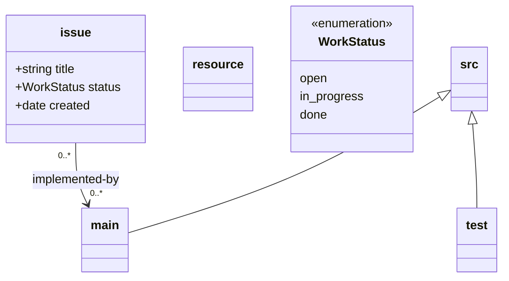

# Prefix unification prototype

Draft for discussion — not yet implemented. Companion to the "unify `@path`
under `@base`/`@prefix`" section in `open-issues.md`. Everything here is
hand-written against the *proposed* semantics; the current CLI still runs
`@path`.

## The scheme

```
%% @prefix <name>: <target> .
```

- `@base` is implicit: the directory containing `document-model.mmd`
  (`$LOOM_DEFAULT_ROOT`), as a `file://` URI. Never written, never changed.
- One mechanism, one keyword. `%% @path` disappears.
- A local class binds its scheme with `%% @prefix issue: <repo:design/issues/> .`
  — the reserved `repo:` scheme means "resolve from the repository root".
- UML inheritance: a class with no `@prefix` inherits its parent's resolved
  target with the class name appended (`src <|-- main` and `src:` at
  `repo:src/` gives `main:` at `repo:src/main/`).
- Subclasses of terminal anchors (`src`, `resource`) keep the same rule —
  parent's target + class name — so `resource <|-- fixture` gives
  `fixture: <resource/…>` only when `resource:` is bound; otherwise the
  default is the class name under the *repo root* (unchanged default).
- External prefixes are just prefixes with an absolute URL target:
  `%% @prefix gh: <https://github.com/org/repo/issues/> .`

## What the model file looks like

`design/document-model.mmd`:



`main:` has **no annotation** — it inherits from `src:` and appends its own
name → `repo:src/cache/`. Wait, no: `main` under `src` appends `main`, so
`repo:src/main/` — the directory is `src/main/`, not `src/cache/`. To point a
subclass at a differently-named folder you annotate it explicitly
(`%% @prefix main: <repo:src/cache/> .`).

## What the generated `.ttl` looks like

`design/.loom/namespaces.ttl` (export-only, regenerated, checked in):

```turtle
# Generated by loom from design/document-model.mmd — do not edit.
@prefix owl: <http://www.w3.org/2002/07/owl#> .
@prefix loom: <https://loom.dev/ns#> .

@prefix :      <file:///tmp/proto/design/> .
@prefix repo:  <repo:> .

# --- classes in the UML model ---
@prefix issue: <repo:design/issues/> .
@prefix src:   <repo:src/> .
@prefix main:  <repo:src/cache/> .
@prefix test:  <repo:tests/> .
@prefix resource: <resource/> .

# --- external resources ---
@prefix gh: <https://github.com/my-org/my-repo/issues/> .

# --- vocabulary: relations, scoped by subject class ---
loom:rel_issue__implemented_by
    a owl:ObjectProperty ;
    rdfs:domain :issue ;
    rdfs:range  :main .
```

`repo:` is *not* expanded to a `file://` absolute in the generated file — it
stays a loom-internal scheme so the `.ttl` stays portable when the repo moves.
A consumer that wants absolute IRIs can compose `@base` + `repo:` themselves;
that composition is the exporter's job at export time, not a stored fact.

## Worked resolutions (prototype repo `/tmp/proto`)

| curie | resolves to | why |
|---|---|---|
| `issue:my-issue.md` | `repo:design/issues/my-issue.md` → `$REPO/design/issues/my-issue.md` | explicit prefix |
| `src:auth.ts` | `repo:src/auth.ts` → `$REPO/src/auth.ts` | explicit prefix |
| `main:store.ts` | `repo:src/main/store.ts` | inherited from `src:` + class name |
| `main:cache/store.ts` (with explicit `%% @prefix main: <repo:src/cache/>`) | `repo:src/cache/store.ts` | explicit annotation |
| `test:auth.test.ts` | `repo:tests/auth.test.ts` | explicit prefix |
| `resource:x.md` | `repo:resource/x.md` | default: class name under repo root |
| `fixture:y.md` (`resource <|-- fixture`) | `repo:fixture/y.md` | inherited name-append |
| `gh:417` | `https://github.com/my-org/my-repo/issues/417` | external |
| `repo:relative/thing.md` | `repo:relative/thing.md` | reserved scheme, no prefix needed |

Note the contrast with today: under `@path`, a subclass of `src` does **not**
nest (each terminal subclass takes its own root); under the unified scheme it
does (name-append). That is a deliberate semantic change to flag — it makes
`main:` address `src/main/` by default, which is arguably what the UML
`<|--` says, but it silently moves existing test subclasses from `test/` to
`src/test/` unless `test:` carries its own prefix. Prototype shows `test:`
annotated explicitly to avoid the move.

## Trailing delimiter

The `/`-or-`#` requirement carries over unchanged — `%% @prefix issue:
<repo:design/issues> .` without the slash is still the hard error
`model/prefix-delimiter` (`issue:my-issue.md` would concatenate into
`design/issuesmy-issue.md`).

## What still needs deciding

1. Default for terminal anchors: under the unified scheme is the `src:`
   default `repo:src/` (name-append against `@base`), or does the reserved
   family keep its special "repo-root default" today? Prototype assumes
   `repo:src/` — i.e. no special case at all, the reserved names are just
   conventional.
2. Does `repo:` stay a *reserved, always-available* scheme (never needs a
   `%% @prefix repo: <repo:> .` line — the prototype writes it only for
   readability), or must it be declared like any other prefix?
3. Confirmation that the generated `.ttl`'s `loom:rel_…` relation terms and
   the `: <>` default-namespace choice look right.
