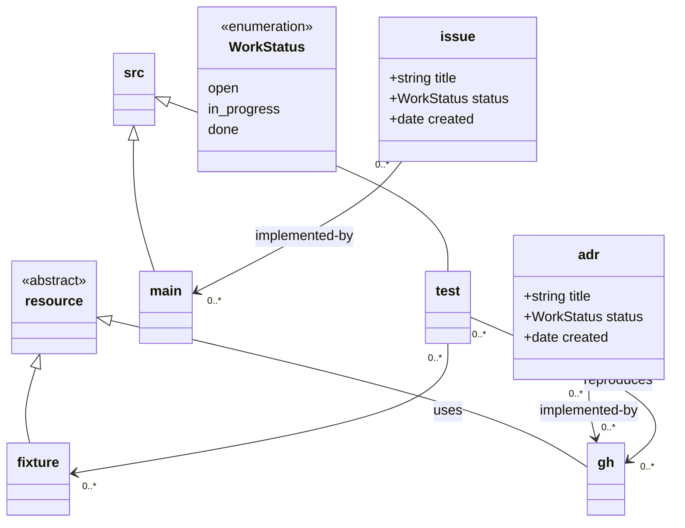

# Prefix unification prototype

**Implemented in 0.10.0.** Companion to the "unify `@path` under
`@base`/`@prefix`" section in `open-issues.md`; current reference is
`architecture.md` §2.2.

One clarification made during implementation: a parent with no root
(abstract, enumeration) is skipped when inheriting, so a subclass of an
abstract `resource` with no prefix of its own defaults to `@base/<name>` —
an explicit prefix is how you get `repo:resource/fixture/`, not a
requirement.

## The scheme

```
%% @prefix <name>: <target> .
```

- `@base` is implicit: the directory containing `document-model.mmd`
  (`$LOOM_DEFAULT_ROOT`), as a `file://` URI. Never written, never changed.
  For this example it will be in `$REPO_ROOT/design/document-model.mmd`
- One mechanism, one keyword. `%% @path` disappears.
— The reserved `repo:` scheme means "resolve from the repository root". This is
  the ONLY absolute path that relates to the local file system in the scheme.
- Unless otherwise specified a local class with no parents resolves to a URI 
  defined by the class name relative to the `@base`. In this example a 
  bare "issue" class in the UML model will resolve to `@base/issue` which in 
  turn resolves to `repo:design/issue`.
- UML inheritance: a class with no `@prefix` inherits its parent's resolved
  target with the class name appended (`src <|-- main` and `src:` at
  `repo:src/` gives `main:` at `repo:src/main/`).
- Any class defaults can be overridden with a `%% @prefix` by specifying a valid
  path - typically from `repo:` e.g. the adr class at `%% @prefix adr: <repo:architecture/decision/> .`
- Subclasses of terminal anchors (`src`, `resource`) keep the same rule —
  parent's target + class name — so `resource <|-- fixture` gives
  `fixture: <resource/…>` only when `resource:` is bound; otherwise the
  default is the class name under the *repo root* (unchanged default).
- External prefixes are just prefixes with an absolute URL target:
  `%% @prefix gh: <https://github.com/org/repo/issues/> .`
- Out of repository targets are just prefixes with a full `file://` URL :
  `%% @prefix data: <file://full/path/to/data/> .`

## What the model file looks like

`design/document-model.mmd`:



`main:` has **no annotation** — it inherits from `src:` and appends its own
name → `repo:src/main/` — the directory is `src/main/`. To point a
subclass at a differently-named folder you annotate it explicitly
(`%% @prefix main: <repo:src/cache/> .`).

## What the generated `.ttl` looks like

`design/.loom/namespaces.ttl` (export-only, regenerated, checked in):

```turtle
# Generated by loom from design/document-model.mmd — do not edit.

# N.b. absolute path commented out see below
# @prefix repo: <file://path/to/repo/> .

@base <repo:design/> .

# --- classes in the UML model ---
# `issue` has no explicit prefix in the model: default = class name under @base.
@prefix issue: <repo:design/issue/> .
@prefix adr:   <repo:architecture/decisions/> .
@prefix src:   <repo:src/> .
@prefix main:  <repo:src/main/> .
@prefix test:  <repo:tests/> .
# N.B. no prefix for resource: because it is abstract, not instantiable.
@prefix fixture: <repo:resource/fixture/> .

# --- external resources ---
@prefix gh: <https://github.com/my-org/my-repo/issues/> .
```

In the future we may try and model the relationships as well. The naming scheme
for the relationships is up for grabs but must be qualified by the UML source
class name. This is my preferred, but non-normative:

```
@prefix owl: <http://www.w3.org/2002/07/owl#> .
@prefix loom: <https://loom.dev/ns/> .

# --- vocabulary: relations, scoped by subject class ---
loom:rel/issue/implemented_by
    a owl:ObjectProperty ;
    rdfs:domain :issue ;
    rdfs:range  :main .
loom:rel/adr/implemented_by
    a owl:ObjectProperty ;
    rdfs:domain :adr ;
    rdfs:range  :gh .
loom:rel/test/uses
    a owl:ObjectProperty ;
    rdfs:domain :test ;
    rdfs:range  :fixture .
loom:rel/test/reproduces
    a owl:ObjectProperty ;
    rdfs:domain :test ;
    rdfs:range  :gh .
```

`repo:` is *not* expanded to a `file://` absolute in the generated file — it
stays a loom-internal scheme so the `.ttl` stays portable when the repo moves.
A consumer that wants absolute IRIs can compose `@base` + `repo:` themselves;
that composition is the exporter's job at export time, not a stored fact.

`repo:` is a *reserved, always-available* scheme (never needs a
`%% @prefix repo: <repo:> .` line. It is in the example above commented out.

Note `@base <repo:design/>` is a *relative* base: turtle resolves it against
the `.ttl` file's own location, which pins the composition to
"ttl-file-directory minus `design/`" — i.e. repo root when the ttl sits in
`design/.loom/`. That is the mechanism that keeps the file portable, and it
means the `.ttl` must always be generated at the same offset from the repo
root as the model directory.

## Worked resolutions (prototype repo `/tmp/proto`)

| curie | resolves to | why |
|---|---|---|
| `issue:my-issue.md` | `repo:design/issue/my-issue.md` → `$REPO/design/issue/my-issue.md` | implicit prefix relative to @base based on class name |
| `src:auth.ts` | `repo:src/auth.ts` → `$REPO/src/auth.ts` | explicit prefix relative to repo: |
| `main:store.ts` | `repo:src/main/store.ts` | inherited from `src:` + class name |
| `adr:001.md` | `repo:architecture/decisions/001.md` | explicit prefix relative to repo: |
| `test:auth.test.ts` | `repo:tests/auth.test.ts` instead of `repo:src/test/auth.test.ts` | explicit prefix overrides inheritance |
| `resource:x.md` | Not allowed | resource is `<<abstract>>` and cannot be instantiated |
| `fixture:y.md` (specialises `resource`) | `repo:resource/fixture/y.md` | explicit prefix required as `resource` is abstract|
| `gh:417` | `https://github.com/my-org/my-repo/issues/417` | external |
| `repo:relative/thing.md` | `repo:relative/thing.md` | reserved scheme, no prefix needed |

In previous implementation under `@path`, a subclass of `src` did **not**
nest (each terminal subclass took its own root). This was a defect and under the unified scheme it
does nest in exactly the same way as other classes (name-append). That is a 
deliberate semantic change to flag — it makes
`main:` address `src/main/` by default, which is arguably what the UML
`<|--` says, but it silently moves existing test subclasses from `test/` to
`src/test/` unless `test:` carries its own prefix. Prototype shows `test:`
annotated explicitly to avoid the move.

As previously if a class has multiple parents it **must** have an explicit prefix
that maps it to a single URI. It is an error if a class resolves to multiple possible URIs
through inheritance.

## `src:` and `resource:` defaults

A couple of options which apply equally to `src` and `resource`:

A) In a completely generic solution a `src` class in the UML without an 
explicit prefix would be treated like any other and interpreted relative to `@base`.
If `document-model.mmd` is in `repo:design/` then `src` woudl naturally resolve to
`repo:design/src` which would be undesirable. It would be mandatory to provide 
a `@prefix` for it to map to a sensible location.

B) A convention over configuration approach would be for a `src` class in the UML with
no explicit prefix resolves to `repo:src`, as that is the most likely real scenario
and overridden with an explicit `@prefix` only when needed. This works OK for the 
majority but might not make so much sense when there is a multi-package layout.

Fundamentally the `src` classes are only different because they cannot have 
frontmatter metadata (and they have internal structure due to the code). `resource`
classes are different because they cannot have metadata or links out (they can 
only be the range of an `owl:ObjectProperty`). Both are declared `<<abstract>>`
rather than `<<interface>>` — loom has no interface stereotype. Confirmed
against the parser: the inline `class resource <<interface>>` spelling makes
tree-sitter emit `model/syntax` plus a phantom class named `""` carrying the
annotation — the annotation is never attached to `resource`. Use the block
form. (If `<<interface>>` proves common in the wild, tolerating it as an
alias for `<<abstract>>` is a one-line change in `isAbstract`; deliberately
not done now.)

In the no surprises ethos option A is better. 

This decision means that all `src:` (and `resource:`) must 
have an explicit URI from `repo:` or relative from `@base`. (N.b. if `document-model.mmd`
is placed in the repository root then `src` will by default resolve to `repo:src`
but in all other cases it must be explicity mapped to the source location in a
repository. This is probably a good thing as source directories vary far more than document directories.

The only alternative is to declare it `<<abstract>>` and explicitly prefix subtypes,
which is what is demonstrated for `resource` in the example.

## Trailing delimiter

The `/`-or-`#` requirement carries over unchanged — `%% @prefix issue:
<repo:design/issues> .` without the slash is still the hard error
`model/prefix-delimiter` (`issue:my-issue.md` would concatenate into
`design/issuesmy-issue.md`).

