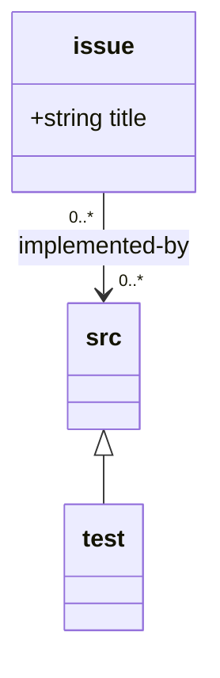
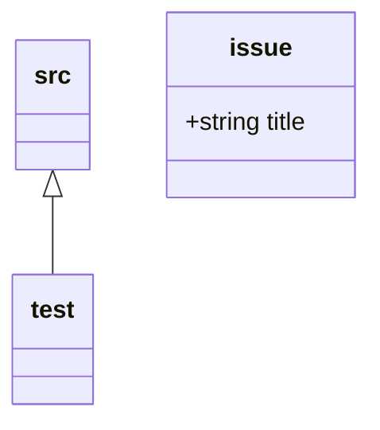
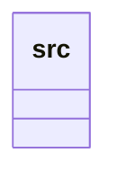
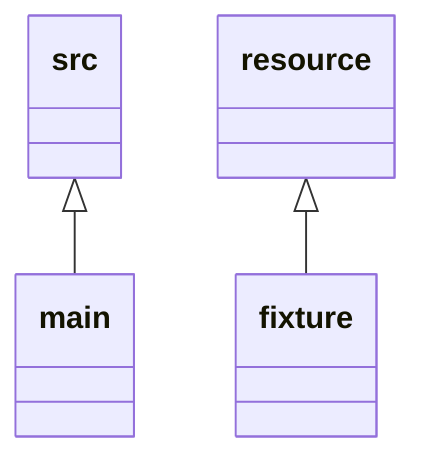
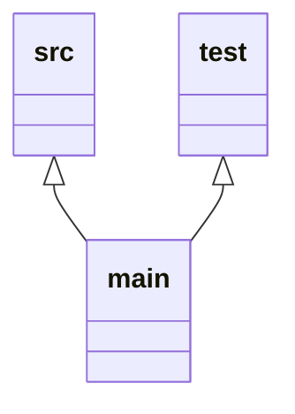
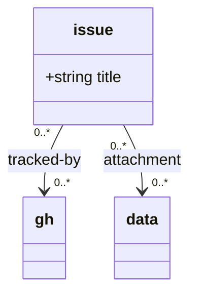

# Prototype models: `@prefix` resolution across model locations

Companion to `prefix-unification.md`. Six minimal cases, each a repository
layout with a `document-model.mmd` and the `.ttl` loom would generate. These
are the acceptance tests in `test/prefix-unification.test.ts` (implemented in
0.10.0). Every case
follows the agreed semantics:

- `@base` is implicit = the directory containing `document-model.mmd`
  (`$LOOM_DEFAULT_ROOT`).
- `repo:` is reserved and always available: target resolves from the repo
  root (git root).
- Default for a parentless class: class name under `@base`.
- Inheritance: parent's resolved target + class name.
- Multiple parents ⇒ explicit prefix required (ambiguous otherwise).
- Terminal anchors get no special casing: a parentless `src` defaults to
  `repo:src` only when the model itself sits at the repo root (case 2);
  anywhere else it must be explicit or it lands under `@base` (case 1 vs 4).

All cases verified against the *current* CLI where behaviour is unchanged;
marked where the unified scheme would change it.

---

## Case 1 — model at `design/` (the common case)

```
repo/
├── design/
│   ├── document-model.mmd      ← @base = repo:design
│   └── .loom/namespaces.ttl
├── src/
└── issues/                     ← NOT design/issues — see model
```

`design/document-model.mmd`:



Resolutions:

| curie | resolves to | why |
|---|---|---|
| `issue:a.md` | `repo:issues/a.md` | explicit prefix — note it is *outside* the design root |
| `src:auth.ts` | `repo:src/auth.ts` | explicit prefix (model is in `design/`, so the no-annotation default would have been `repo:design/src`) |
| `test:auth.test.ts` | `repo:src/test/auth.test.ts` | inherited from `src:` + class name |

`design/.loom/namespaces.ttl`:

```turtle
# Generated by loom — do not edit. Model: design/document-model.mmd
# @base = the model's directory, expressed relative to this file's location.
@base <../> .

# --- classes ---
@prefix issue: <repo:issues/> .
@prefix src:   <repo:src/> .
@prefix test:  <repo:src/test/> .
```

## Case 2 — model at the repo root

```
repo/
├── document-model.mmd          ← @base = repo root
├── issue/
├── src/
└── .loom/namespaces.ttl
```

`document-model.mmd`:



Resolutions (this is the one layout where no annotation is needed at all):

| curie | resolves to | why |
|---|---|---|
| `issue:x.md` | `repo:issue/x.md` → `$REPO/issue/x.md` | parentless class default = class name under `@base` = repo root. **Verified with the current CLI** (`resolve` → `$REPO/issue/x.md`) |
| `src:auth.ts` | `repo:src/auth.ts` | same rule for a terminal anchor — no special case needed |
| `test:auth.test.ts` | `repo:src/test/auth.test.ts` | inherited |

`.loom/namespaces.ttl`:

```turtle
# Generated by loom — do not edit. Model: document-model.mmd
# @base = the model's directory = repo root here.
@base <../> .

# --- classes ---
@prefix issue: <issue/> .        # generated form would be <repo:issue/>
@prefix src:   <repo:src/> .
@prefix test:  <repo:src/test/> .
```

Note `issue:` is written *without* the `repo:` scheme — relative to `@base`
(repo root), which here equals the repo root. The generator always emits
`repo:` uniformly; the bare relative spelling is shown once here to make the
`@base`-relative reading explicit. Both resolve identically in this layout.

## Case 3 — monorepo: one loom per package

```
repo/
└── packages/
    ├── web/
    │   ├── design/
    │   │   ├── document-model.mmd   ← web's @base
    │   │   └── .loom/namespaces.ttl
    │   └── src/
    └── api/
        └── design/
            └── document-model.mmd   ← a second model — model/ambiguous?
```

`packages/web/design/document-model.mmd`:



Resolutions:

| curie | resolves to | why |
|---|---|---|
| `src:a.ts` | `repo:src/a.ts` → `packages/web/src/a.ts` | **repo root is the git root**, not the package — verified with the current CLI (`resolve` → `$REPO/packages/web/src/a.ts`) |

The critical point: `repo:` is anchored at the **git root** even when the
model is deep in a monorepo, so `repo:src/` escapes the package. If the
package should be self-contained, the model has to spell it out:

```mermaid
%% @prefix src: <repo:packages/web/src/> .
```

That is the trade-off case 3 demonstrates: `@base` follows the model, `repo:`
follows the git root, and the two only coincide at case 2.

Two mitigations for the package-escapes-the-package problem:

**Mitigation A — relative prefix.** Link to source with a path relative to
`@base` rather than the repo root:

```mermaid
%% @prefix src: <../src/> .
```

For *both* packages this resolves correctly (`packages/web/design/../src` and
`packages/api/design/../src` are each package-local). The cost: today's
one-model-per-repository discovery would stop the second model from working,
so mitigation A alone does not give two working looms in one git repo.

**Mitigation B — configurable repo root.** Add `LOOM_REPO_ROOT` to the
requirements, autodetected as the git repository root but overridable:

```bash
LOOM_REPO_ROOT=$REPO/packages/web loom validate
LOOM_REPO_ROOT=$REPO/packages/api loom validate
```

Each invocation is then a self-contained loom over its own package: `repo:`
anchors at the override, `.loom/` and the per-branch duckdb land in the
package's design directory, and the `repo:` prefixes in the example work
as-is. This is the mechanism that makes case 2's "model at repo root" layout
available *inside* a monorepo package.

`packages/web/design/.loom/namespaces.ttl` (mitigation B in force, or
mitigation A with the relative spelling):

```turtle
# Generated by loom — do not edit. Model: packages/web/design/document-model.mmd
# This loom's @base is packages/web/design; repo: anchors at LOOM_REPO_ROOT
# (the package when overridden, otherwise the git root).
@base <../> .

# --- classes ---
@prefix src: <repo:src/> .
```

**Decision:** mitigation B (`LOOM_REPO_ROOT`) is required for the multi-model
story; mitigation A is available as pure sugar. Both should appear in the
implementation's acceptance tests.

TWO MITIGATIONS:

use relative path for link to source:

```
%% @prefix src: <../src/> .
```

for both models this will resolve correctly, but current one model per repository
will prevent second model from working.

To fix that we could parameterise the LOOM_REPO_ROOT which is autodetected as
the git repository root and call loom twice once for each package:

`LOOM_REPO_ROOT=/repo/packages/web loom validate` and
`LOOM_REPO_ROOT=/repo/packages/api loom validate`

This second mitigation would allow the `repo:` example to work in the example 
as-is.

## Case 4 — `src`/`resource` families relocated explicitly

The "no surprises" option A: terminal anchors get **no** default beyond the
parentless rule, so a model in `design/` that wants code in the conventional
place must say so — and can equally put it anywhere.

```
repo/
├── design/document-model.mmd
├── server/src/
├── assets/
└── design/.loom/namespaces.ttl
```

`design/document-model.mmd`:



Resolutions:

| curie | resolves to | why |
|---|---|---|
| `src:auth.ts` | `repo:server/src/auth.ts` | explicit override |
| `main:server.ts` | `repo:server/src/main/server.ts` | inherited + name |
| `resource:logo.svg` | `repo:assets/logo.svg` | explicit override |
| `fixture:sample.svg` | `repo:assets/fixture/sample.svg` | inherited + name |

Note the nesting now applies to resource subclasses too (`assets/fixture/`),
where today `@path` would have given `fixture:` its own root. Under the
unified scheme there is no "own root" rule at all.

`design/.loom/namespaces.ttl`:

```turtle
# Generated by loom — do not edit. Model: design/document-model.mmd
@base <../> .

# --- classes ---
@prefix src:      <repo:server/src/> .
@prefix main:     <repo:server/src/main/> .
@prefix resource: <repo:assets/> .
@prefix fixture: <repo:assets/fixture/> .
```
## Case 5 — multiple parents: explicit prefix mandatory

```
repo/
├── design/document-model.mmd
└── design/.loom/namespaces.ttl
```

`design/document-model.mmd`:



Without the `main:` line this is the ambiguity error: `main` inherits two
different targets (`repo:src/main` and `repo:tests/main`), so resolution
through inheritance alone is undefined. The explicit prefix resolves it.
This is today's behaviour too (inherited roots collide → `path/collision`)
restated in prefix terms.

`design/.loom/namespaces.ttl`:

```turtle
# Generated by loom — do not edit. Model: design/document-model.mmd
@base <../> .

# --- classes ---
@prefix src:  <repo:src/> .
@prefix test: <repo:tests/> .
@prefix main: <repo:src/main/> .
```
## Case 6 — external + out-of-repo prefixes alongside

```
repo/
├── design/document-model.mmd
├── design/issues/
└── design/.loom/namespaces.ttl
```

`design/document-model.mmd`:



Resolutions:

| curie | resolves to | why |
|---|---|---|
| `issue:a.md` | `repo:design/issue/a.md` | relative target against `@base` |
| `gh:417` | `https://github.com/my-org/my-repo/issues/417` | absolute URL — external |
| `data:sensors.csv` | `file:///srv/shared-data/sensors.csv` | absolute `file://` — outside the repo, linkable but never checked by `stat` |

All three are the same keyword; the target's own scheme decides whether the
base is applied. An absolute target ignores `@base` entirely.

`design/.loom/namespaces.ttl`:

```turtle
# Generated by loom — do not edit. Model: design/document-model.mmd
@base <../> .

# --- classes ---
@prefix issue: <issue/> .
@prefix gh:   <https://github.com/my-org/my-repo/issues/> .
@prefix data: <file:///srv/shared-data/> .
```

---

## Test-fixture matrix (for implementation)

When implementing, these six layouts become the acceptance tests:

| # | assertion |
|---|---|
| 1 | `issue:` resolves outside the design root when prefixed `repo:issues/` |
| 1 | `src:` explicit is required when model is not at repo root (absence → `repo:design/src`) |
| 2 | model at repo root: zero annotations, all defaults, `issue:` → `$REPO/issue` |
| 3 | `repo:` anchors at git root even from a nested model |
| 4 | terminal anchors relocate exactly like any other class; nesting applies to their subclasses |
| 5 | multi-parent without explicit prefix = hard error; with prefix = resolves |
| 6 | one keyword, three target kinds: relative, `https://`, `file://`; absolute targets ignore `@base` |
