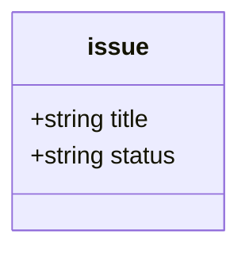
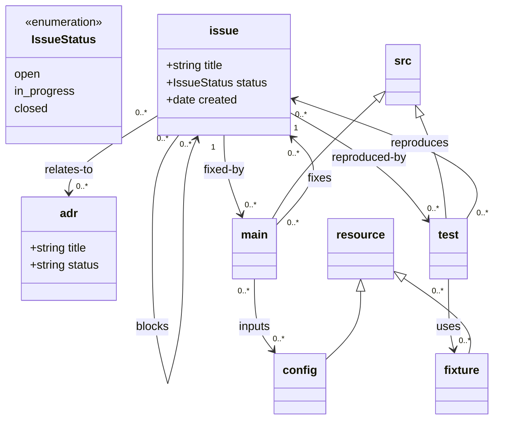

# Creating a Loom Workflow

This meta-skill guides an agent through establishing a documentation architecture and project methodology using `loom`, tailoring the schema, configuring the tooling, generating navigation, and codifying the repository's document lifecycle into a project-specific methodology skill.

## When to Use This Skill

- Setting up `loom` in a repository for the first time, or updating an existing methodology.
- Modeling design artefacts (ADRs, RFCs, Issues, Requirements, Test Plans, Services).
- Defining document lifecycle transition rules (e.g. `draft` -> `review` -> `accepted` -> `implemented`).
- Creating a companion project-specific workflow skill (e.g. `manage-architecture-docs`, `issue-lifecycle-workflow`) tailored to the repository's domain model.

---

## Step 1: Discover & Map Requirements

What is the nature of the project and how best does documentation and workflow support the project?

For example a software development project may use a agile workflow, a project management project may use prince, a research project may have altogether different methodology. Loom can support any arbitrary methodology. You will need to discuss what methodology fits best with the project given the objectives and research alternatives.

Determine the document classes and lifecycle needs:
1. **Document Types**: What kinds of artefacts exist? (e.g. `adr`, `issue`, `rfc`, `spec`, `testplan`).
2. **Relationships**: How do they connect?
   - Between documents: e.g. `issue` blocks `issue`, `adr` addresses `rfc`.
   - To source code: e.g. `issue` implemented-by `src`, `src` implements `spec`.
3. **Attributes & Value Types**: Required metadata (title, status, date, author, priority).
4. **Lifecycle & Transitions**: What are the valid states and transition rules for each class?
   - e.g. Can an `issue` transition to `closed` if its `blocks` relation points to an open issue?
   - Does an `adr` require an `accepted` status before code implements it?

---

## Step 2: Define the Mermaid Model (`document-model.mmd`)

Place the model at `$LOOM_DEFAULT_ROOT/document-model.mmd` (typically `design/document-model.mmd`).
`$LOOM_DEFAULT_ROOT` is determined by where you place this file, or can be explicitly
set as an env var.

### Rules & Conventions
- **Class naming**: A class name becomes a URI scheme, so it must start with a
  letter and contain only letters, digits, and underscores. Dashes, dots and
  spaces are rejected by the mermaid grammar (`adr-001` fails with
  `model/syntax`). **Prefer camelCase** (`issueStatus`, `adr2`): no
  underscores in uris to type or read, and it stays a valid scheme should the
  model ever be exported to RDF (which does not allow `_` in scheme names).
  snake_case works but is second choice. Matching is case-insensitive
  (`ADR:` and `adr:` are the same scheme); the canonical form is the
  spelling used in the model.
- **Instantiable Classes**: Concrete classes that become Markdown files.
- **Attributes**: One per line with visibility and type (e.g. `+string title`, `+IssueStatus status`).
  - Supported primitives: `string`, `int`, `float`, `bool`, `date`, `path`, `uri`.
  - **Cardinality (list)**: mermaid's generic syntax — `+List~string~ tags`. The `[]` suffix (`+string[] tags`) is **rejected by the mermaid grammar** and the attribute is silently dropped, so always use `List~T~`.
  - **Class-typed (composite)**: A non-primitive type embeds a nested YAML block; the frontmatter carries a nested object (or list of objects). Such attributes project as DuckDB STRUCTs (or STRUCT[]) so subfields are queryable (`reporter.name`) and misspellings fail loudly with a Binder Error.
  - **Cardinality (relation)**: The mermaid spec's shorthands are all supported: `1`, `0..1`, `1..*`, `*`, `n`, `1..n`, `0..n`, plus the symmetrical keywords `one` (= `1..1`) and `many` (= `0..*`).
- **Enumerations**: Label with `<<enumeration>>` and list allowable members.
  - **Declare members in a meaningful order.** They project into DuckDB as a native `ENUM`, so `ORDER BY`, `MIN`/`MAX` and `list_sort` follow declaration order, not alphabetical order. Declaring a lifecycle in its natural progression (`backlog`, `in_progress`, `review`, `done`) makes boards and reports sort correctly for free.
  - Changing the members requires `loom rebuild` before queries reflect it.
  - Do not name an enumeration after a built-in database type (`date`, `blob`, ...) — it cannot be projected.
- **Abstract Classes**: Label with `<<abstract>>` (not directly instantiated). Used both as supertypes and as the type of class-typed attributes.
- **Inheritance**: Expressed with `<|--` (e.g. `document <|-- adr`).
- **Source Code Integration**: Use or subclass the reserved `src` class.
  - Subclasses of `src` get their own scheme and nest under `src`'s folder (`src <|-- test` → `src/test`) unless given their own `%% @prefix`.
  - Unless the model sits at the repo root, declare where code lives: `%% @prefix src: <repo:src/> .`
  - Loom forbids structured YAML on the `src` family — anchors carry no frontmatter.
- **Data or external resource integration**: Use or subclass the reserved `resource` class.
  - Subclasses of `resource` get their own scheme and nest under `resource`'s folder (e.g. `resource <|-- fixture`); an external resource is a class whose `%% @prefix` target is a URL (e.g. `%% @prefix gh: <https://github.com/org/repo/issues/> .`, see Appendix B).
  - Loom classes can link to `resource` family items but cannot link from, and they have no metadata.
- **Inline Views**: Define named SQL queries directly in the model with `%% @view <name>`, a multi-line body using continuation `%%` lines. Parameters use `$name` placeholders; list params are comma-separated (see Step 6).
- **Relations**: Arrow `-->` with cardinality at both ends and relation label:
  ```mermaid
  %% @prefix src: <repo:src/> .
  classDiagram
      class IssueStatus {
          <<enumeration>>
          open
          in_progress
          resolved
          closed
      }

      class issue {
          +string title
          +IssueStatus status
          +date created
      }

      class adr {
          +string title
          +string status
          +date accepted_date
      }

      issue "0..*" --> "0..*" issue : blocks
      issue "0..*" --> "0..*" adr : relates-to
      issue "1" --> "0..*" src : implemented-by
      src "0..*" --> "0..*" issue : implements
  ```

Validate the model syntax:
```bash
loom model check
```

---

## Step 3: Zero Configuration & Model Placement

Loom operates without a config file by default — class roots are declared
in the model itself (see Appendix A). The only things an optional
`.loom.yaml` can set are the **design root** and the **anchor policy**:

```yaml
designRoot: design
source:
  anchorKinds: [function_declaration, method_definition, arrow_function, function_definition]
  transparentKinds: [export_statement, statement_block]
```

Grammars are not configured: they download lazily on first parse, and
`loom prefetch <languages...>` warms them for offline use.

It discovers `document-model.mmd` in the git repository:
- The parent directory of `document-model.mmd` becomes `$LOOM_DEFAULT_ROOT` (e.g. `docs` or `design`).
- Optional environment overrides:
  - `LOOM_DEFAULT_ROOT`: Specifies the root directory relative to repository root if multiple models exist.
  - `LOOM_REPO_ROOT`: Overrides the git root, which is what `repo:` means — e.g. one self-contained loom per monorepo package.

Class locations are declared directly in the model via `%% @prefix <class>: <target> .`
lines at the beginning of the mermaid class file (see Appendix A). Unless the model sits
at the repository root, `src` needs one: `%% @prefix src: <repo:src/> .`

Run initial validation to verify graph structure:
```bash
loom validate
```

---

## Step 4: Configure Navigational Index Views

Human readers navigate the corpus via Markdown links. Create index files under `$LOOM_DEFAULT_ROOT` with `class: index` and a `view`.

### Filter View Example (`$LOOM_DEFAULT_ROOT/INDEX.md`)
```markdown
---
class: index
title: Project Index
view:
  class: issue
  where:
    status: open
  orderBy: created DESC
---

# Open Issues

<!-- loom:links start -->
<!-- loom:links end -->
```

### SQL Query View Example (`$LOOM_DEFAULT_ROOT/adrs/INDEX.md`)
```markdown
---
class: index
title: Architecture Decision Records
view:
  query: "SELECT uri, title FROM adr ORDER BY accepted_date DESC"
---

# Architecture Decisions

<!-- loom:links start -->
<!-- loom:links end -->
```

Generate the link blocks:
```bash
loom index
```

---

## Step 5: Codify the Lifecycle & Transition Rules

Identify state machines and invariants that agents or contributors must respect when modifying documents.

For example, for an Issue Tracker:
1. **Creation**:
   - Must specify `title` and initial `status: open`.
   - Filename slug matches title (e.g. `issue:fix-token-refresh.md`).
2. **Transition: `open` -> `in_progress`**:
   - Permitted if no unresolved blocking issues (`blocks`).
   - Agent links relevant source files or branches.
3. **Transition: `in_progress` -> `resolved`**:
   - Must have at least one `implemented-by` or `implements` relation pointing to source code.
   - All tests passing.
4. **Transition: `resolved` -> `closed`**:
   - Final review or verification completed.

---

## Step 6: Add Inline Views (Live Data in Markdown Files)

Add `%% @view` annotations to `document-model.mmd` for SQL queries you want
to embed in markdown files. Inline views render live data from the DuckDB graph
into any `.md` file via `<!-- loom view: ... -->` markers.

### Example: View definition in the model



### Example: View marker in a markdown file

```markdown
## Open Issues

<!-- loom view: blocking_issues -->
<!-- loom view: blocking_issues end -->

## By Status

<!-- loom view: by_status -->
<!-- loom view: by_status end -->
```

Running `loom render` replaces the span between a marker and its end marker
with the query result as a markdown table (2–4 columns), bullet list (1
column), or compact bold-key list (5+ columns). End markers are qualified
(`<!-- loom view: <name> end -->`) so several views can share one page; a
missing end marker is fine — `loom render` inserts the content and the
qualified end right after the marker, leaving surrounding prose untouched (a
bare `<!-- loom view: end -->` is also accepted). `loom render --check` is the CI-safe variant
that exits 1 if any marker would change.

### Parameters

Pass values via query-string syntax; the SQL uses `$name` placeholders:

```markdown
<!-- loom view: blocking_issues?status=in_progress&limit=5 -->
```

```mermaid
    %% @view blocking_issues
    %% SELECT uri, title, status
    %% FROM issue
    %% WHERE status = '$status'
    %% LIMIT $limit
```

List params use comma-separated values: `status=open,closed` expands to
`IN ('open', 'closed')`. Backslash-escaped commas are literal (`foo\,bar` is
one value).

### Inline SQL (no model definition)

```markdown
<!-- loom view: SELECT count(*) AS cnt FROM issue -->
<!-- loom view: end -->
```

Inline SQL needs no `%% @view` annotation; just write `SELECT` after the marker.

### When to use vs `loom index`

| Feature | `loom index` | `loom render` |
|---|---|---|
| Managed link blocks | Yes | No |
| Editable prose | No | No (read-only output) |
| Inline in any document | No | Yes |
| Parameters per invocation | No | Yes (`?key=val`) |
| CI check | `--check` | `--check` |

To migrate existing `view:`-based index files to `%% @view` annotations,
see [Appendix D](#appendix-d--migration-guide-view-frontmatter--view-annotations).

---

## Step 7: Generate the Project-Specific Workflow Skill

To ensure future agents operate reliably within this specific repository, create a dedicated skill (e.g. `<project>-design-workflow/SKILL.md` in the repository's skill directory - `.agents/skills`).

Reference this skill in the `AGENTS.md` file.

Copy the `document-model.mmd` file into the skill's `references/` subdirectory for future re-use.

For complete, end-to-end examples of document models paired with their companion workflow skills (including Agile feature tracking and Getting Things Done), see:
- [`references/example-workflows.md`](references/example-workflows.md)

### Example template for Generated Workflow Skill:

This template needs to be adapted to reflect the project workflow and document model.

```markdown
---
name: <project>-methodology
description: Procedures, validation rules, and lifecycle transitions for managing workflow in <project>. 
Use when creating, updating, or reviewing project documentation, tracking and updating project state, or linking in supporting code or data.
---

# <Project> methodology

This repository uses \`loom\` governed by \`$LOOM_DEFAULT_ROOT/document-model.mmd\`.
Refer to \`using-loom-cli\` for general CLI operation syntax.

## 1. Document Classes & Locations
- Issues: \`issue:<name>.md\` -> \`$LOOM_DEFAULT_ROOT/issue/<name>.md\` (class default: no %% @prefix needed)
- ADRs: \`adr:<name>.md\` -> \`$LOOM_DEFAULT_ROOT/adr/<name>.md\` (class default)

## 2. Common Operations

### Creating an Issue
\`\`\`bash
loom create issue:my-task.md "title: My Task" "status: open" "created: $(date +%Y-%m-%d)"
\`\`\`

### Linking Code to an Issue
When implementing an issue in code:
\`\`\`bash
loom link src:feature.ts#handleTask implements issue:my-task.md
\`\`\`

### Writing the Issue's Prose
Edit the markdown body through loom, never with a file editor — this
cannot touch the frontmatter or the generated link block. Use `--file`
to avoid quoting/escaping multiline text in bash:
\`\`\`bash
loom --json body get issue:my-task.md
loom body append issue:my-task.md "
## Cause

Session cookie expires early.
"
# or write to /tmp/prose.md and load directly:
loom body set issue:my-task.md --file /tmp/prose.md
\`\`\`
Write links as design URIs (\`[ADR](adr:auth.md)\`); loom stores them as
relative markdown links and returns them as URIs.

## 3. Lifecycle Transition Rules

### Moving an Issue to in_progress
- Check if blocked:
  \`\`\`bash
  loom query "SELECT object FROM edge WHERE subject = 'issue:my-task.md' AND relation = 'blocks'"
  \`\`\`

### Resolving an Issue
- Ensure code link exists:
  \`\`\`bash
  loom refs src:path/to/code.ts#symbol
  \`\`\`
- Update status:
  \`\`\`bash
  loom set issue:my-task.md status resolved
  \`\`\`

## 4. Pre-Commit Checklist
Always run before committing changes to design docs:
1. \`loom validate --fix\`
2. \`loom index\`
3. `loom render` (regenerate any inline view markers)
4. Verify zero errors in \`design/VALIDATION.md\`

```

---

## Step 8: Verification Checklist

1. Model passes `loom model check`.
2. Graph validates clean with `loom validate`.
3. Indexes update cleanly with `loom index`.
4. Inline views render cleanly with `loom render`.
5. Git pre-commit or CI check runs `loom validate && loom index --check && loom render --check`.
6. The companion `using-loom-cli` skill is present and referenced.

---

## Appendix A — Path resolution reference (`%% @prefix`)

Class roots are declared in the model itself, not in a config file. A
`%% @prefix <class>: <target> .` line binds a class scheme to a location.
(The old `%% @path` form is rejected with `model/path-removed`; its fix
names the equivalent `@prefix` line.)

### A.1 Syntax

```
%% @prefix <class>: <target> .
```

- `@base` is implicit: the directory holding `document-model.mmd`.
- `<target>` must end in `/` (or `#`), and is one of:
  - **`repo:path/`** — repo-rooted: `%% @prefix config: <repo:input/> .` → `$REPO_ROOT/input`.
    `repo:` is reserved and always available; it means the git root, or
    `LOOM_REPO_ROOT` if set.
  - **Relative** (`issues/`, `../src/`) — resolved against `@base`.
  - **Absolute URL** (`https://…/`, `file:///…/`) — external (Appendix B).
- **Default** with no prefix: see A.3.

### A.2 `src` and `resource`

`src` and `resource` are reserved families — no structured YAML, no
attributes — but they **resolve like any other class**. With the model in
`design/`, an unprefixed `src` is `design/src`, so point it at the code:

```mermaid
%% @prefix src: <repo:src/> .
%% @prefix resource: <repo:data/> .
src <|-- test
src <|-- main
resource <|-- fixture
```

Resolves to:
- `src:`      → `$REPO_ROOT/src`
- `main:`     → `$REPO_ROOT/src/main`   (parent + name)
- `test:`     → `$REPO_ROOT/src/test`   (parent + name)
- `resource:` → `$REPO_ROOT/data`
- `fixture:`  → `$REPO_ROOT/data/fixture`

Give a subclass its own prefix to put it elsewhere
(`%% @prefix test: <repo:tests/> .`). A model at the repository root gets
`src/` and `resource/` for free.

### A.3 Inheritance-driven default

If a class has no `%% @prefix`:

1. **With a UML parent**: the parent's root plus the class name. Parents
   with no root (abstract, enumeration) are skipped. Two parents giving
   different roots is `path/ambiguous-inheritance` — add a prefix.
2. **No rooted parent**: `@base` plus the class name.

### A.4 Path attributes and URI attributes

Two primitive types carry locations:

- `path`: a repo-relative filesystem path (e.g. `design/notes.md`).
  Validated for existence; used by `loom validate`.
- `uri`: a design URI (`issue:a.md`). Validated against the model
  (scheme must exist; class must be valid for the relation); used for
  edges.

### A.5 Worked example



With the model at `$REPO_ROOT/docs/document-model.mmd`:

```
issue:    -> $REPO_ROOT/docs/issue
adr:      -> $REPO_ROOT/architecture/design-records
src:      -> $REPO_ROOT/src
main:     -> $REPO_ROOT/src/main
test:     -> $REPO_ROOT/src/test
resource: -> $REPO_ROOT/docs/resource
fixture:  -> $REPO_ROOT/test-fixtures
config:   -> $REPO_ROOT/input
```

`loom rebuild` writes these as turtle to `docs/.loom/namespaces.ttl`
(export-only, checked in).

### A.6 Rules & edge cases

- **Repo boundary**: a resolved path that escapes `$REPO_ROOT` (via `..`)
  is a validation error.
- **Missing directory**: Loom emits a warning for every resolved root that
  does not exist on disk, including default paths under UML parents — so
  typos in class names or `@prefix` targets surface consistently for
  both humans and agents.
- **Canonicalisation**: a filesystem path resolves to the longest matching
  class URI scheme (`src/auth.ts` → `main:auth.ts` if `main` is `src/main`).
  No match → the `repo:` scheme (`repo:relative/path`).
- **No config file**: `.loom.yaml` is optional. With no config, the
  defaults above apply.

---

## Appendix B — External prefixes (`%% @prefix`)

A curie usually names a class located by `%% @prefix` or its default, but a
prefix whose target is an absolute URL binds a scheme to something outside the
repository:

```
%% @prefix gh: <https://github.com/my-org/my-project/issues/> .
```

- The target **must end in `/` or `#`** — curie expansion is string
  concatenation, not path join, so a bare `.../issues` would turn `gh:6`
  into `.../issues6`. A declaration missing the delimiter is a hard error
  (`model/prefix-delimiter`).
- `gh:6` expands to `https://github.com/my-org/my-project/issues/6`.
- An external scheme wins over a class of the same name.
- Relational targets under an external scheme skip the filesystem
  existence check (there is no local file to find).
- Inline views render such cells as `[gh:6](expanded-url)`; body editing
  translates between the curie and the url in both directions.

---

## Appendix C — Anchor policy (source linkage)

`src`-family instances point to source-code anchors (symbols, not whole
files). The anchor model is policy-driven; configuration lives in
`.loom.yaml`:

```yaml
source:
  anchorKinds: [Function, Method, Class, Struct, Interface, Enum, Trait]
  transparentKinds: [Impl, Module, Namespace]
```

- `anchorKinds`: tree-sitter structure kinds that qualify as anchors. An
  anchor not on this list is rejected.
- `transparentKinds`: containers that should be descended into without
  becoming anchors themselves.

Grammars are not listed here. They load lazily on the first parse of a
file in that language; `loom prefetch <languages...>` pre-warms them for
offline or sandboxed runs.

Ambiguous anchors (the same name at multiple line numbers) are a hard
error — there is no silent "first match wins" within a single file. Use
the `disambiguate` skill or rewrite the source to disambiguate before
committing.

Commands:
- `loom ls <uri>`: enumerate a directory, a symbol's body, or a class.
- `loom locate <uri> --line <n>`: find the enclosing symbol for a line.
- `loom refs <srcUri>`: list relations pointing at a source anchor.
- `loom link <srcUri> implements <docUri>`: write a reverse-link comment
  into the source file at the anchor (R, TS, Python — language-specific
  comment syntax).
- `loom unlink <srcUri> <relation> <docUri>`: remove the comment.
- `loom validate --fix`: run drift repair (fills missing anchors,
  canonicalises stale paths, fixes corrupt reverse-link comments).

Git rename inference is on by default: when an anchor disappears, loom
compares the missing line against `HEAD` and proposes a rename before
treating it as a deletion.

---

## Appendix D — Migration Guide: `view:` frontmatter → `%% @view` annotations

Before inline views, index files used a `view:` field in YAML frontmatter and
`<!-- loom:links ... -->` markers that `loom index` filled with auto-generated
link blocks. The new `%% @view` + `<!-- loom view: ... -->` approach is more
flexible — any file, with parameters, inline SQL — and the old approach
remains supported. This guide helps you migrate one index file at a time.

### Old format (still works)

**Model** (no view annotations):


**Index file** (`issues/INDEX.md`):
```markdown
---
class: index
title: Open Issues
view:
  class: issue
  where:
    status: open
  orderBy: created DESC
---

# Open Issues

<!-- loom:links start -->
<!-- loom:links end -->
```

Processed by: `loom index` → generates link block. Works forever.

### New format (recommended for new files, migrate when convenient)

**Model** (add `%% @view`):


**Index file** (`issues/INDEX.md`) — drop the `view:` frontmatter, replace
`<!-- loom:links -->` markers with `<!-- loom view: -->`:
```markdown
---
class: index
title: Open Issues
---

# Open Issues

<!-- loom view: open_issues -->
<!-- loom view: open_issues end -->
```

Processed by: `loom render` → replaces the span with a table. Mark old
`class: index` as a data-only annotation — the file is no longer special
to `loom index` (but keeping `class: index` does not break anything).

### Step-by-step recipe

1. Add a `%% @view <name>` annotation to `document-model.mmd` with the SQL
   query that matches what the old `view:` block was doing.
2. Verify the query works: `loom rebuild && loom query "<your SQL>"`.
3. Open the index file, remove the `view:` key from frontmatter (leave
   `class: index` — harmless), and replace the `<!-- loom:links start -->`
   / `<!-- loom:links end -->` pair with `<!-- loom view: <name> -->`
   (the end marker is inserted by `loom render`).
4. Run `loom render` to fill in the table.
5. Delete the old generated content between the markers — `loom render`
   replaces it anyway, but the file is cleaner to read before CI runs.
6. Run `loom validate` and `loom index --check` to confirm nothing is
   broken. Both commands coexist with `loom render`.

### What stays the same

- The **`class: index`** frontmatter field is purely informational — it does
  not conflict with `loom render` and does not need to be removed.
- **`loom index`** still works. Mix old-style and new-style index files in the
  same repository.
- **Validation and CI** still use `loom validate` and `loom index --check`;
  add `loom render --check` to catch stale view markers.

### When not to migrate

- If the index file is purely a navigational listing of instances with no
  custom SQL, the old `view:
    class: issue
    where:
      status: open`
  syntax is simpler to write and there is no benefit to rewriting it.
- If the index file is rarely opened or exists only for machine consumption,
  leave it alone.

### Parametrized index example

A migrated index that accepts a `status` parameter:

```mermaid
    %% @view indexed_issues
    %% SELECT uri, title, status, created
    %% FROM issue
    %% WHERE status = '$status'
    %% ORDER BY created DESC
```

```markdown
---
class: index
---

<!-- loom view: indexed_issues?status=open -->
<!-- loom view: indexed_issues end -->
```
