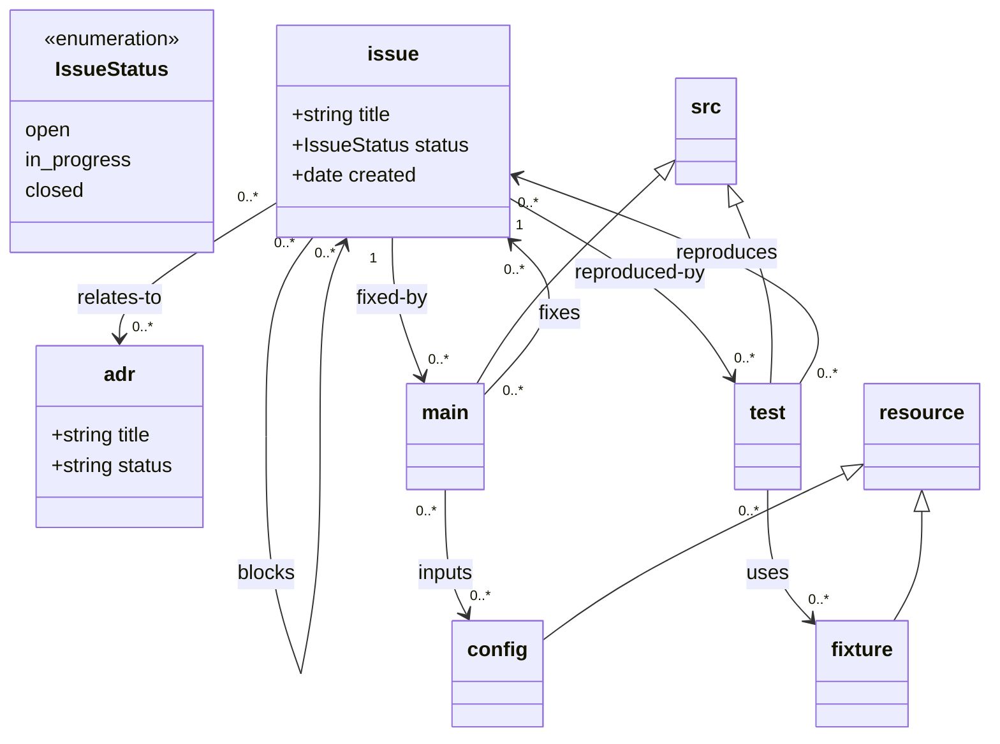

# Creating a Loom Workflow

This meta-skill guides an agent through establishing a documentation architecture using `loom`, tailoring the schema, configuring the tooling, generating navigation, and codifying the repository's document lifecycle into a project-specific workflow skill.

## When to Use This Skill

- Setting up `loom` in a repository for the first time.
- Modeling design artefacts (ADRs, RFCs, Issues, Requirements, Test Plans, Services).
- Defining document lifecycle transition rules (e.g. `draft` -> `review` -> `accepted` -> `implemented`).
- Creating a companion project-specific workflow skill (e.g. `manage-architecture-docs`, `issue-lifecycle-workflow`) tailored to the repository's domain model.

---

## Step 1: Discover & Map Requirements

Determine the document classes and lifecycle needs:
1. **Document Types**: What kinds of artefacts exist? (e.g. `adr`, `issue`, `rfc`, `spec`, `testplan`).
2. **Relationships**: How do they connect?
   - Between documents: e.g. `issue` blocks `issue`, `adr` addresses `rfc`.
   - To source code: e.g. `issue` implemented-by `src`, `src` implements `spec`.
3. **Attributes & Value Types**: Required metadata (title, status, date, author, priority).
4. **Lifecycle & Transitions**: What are the valid states and transition rules for each class?
   - e.g. Can an `issue` transition to `closed` if its `blocks` relation points to an open issue?
   - Does an `adr` require an `accepted` status before code implements it?

---

## Step 2: Define the Mermaid Model (`document-model.mmd`)

Place the model at `$LOOM_DEFAULT_ROOT/document-model.mmd` (typically `design/document-model.mmd`).
`$LOOM_DEFAULT_ROOT` is determined by where you place this file, or can be explicitly
set as an env var.

### Rules & Conventions
- **Instantiable Classes**: Concrete classes that become Markdown files.
- **Attributes**: One per line with visibility and type (e.g. `+string title`, `+IssueStatus status`).
  - Supported primitives: `string`, `int`, `float`, `bool`, `date`, `path`, `uri`.
  - **Cardinality (list)**: `[]` suffix for lists (e.g. `+string[] tags`).
  - **Class-typed (composite)**: A non-primitive type embeds a nested YAML block; the frontmatter carries a nested object (or list of objects). Such attributes project as DuckDB STRUCTs (or STRUCT[]) so subfields are queryable (`reporter.name`) and misspellings fail loudly with a Binder Error.
  - **Cardinality (relation)**: The mermaid spec's shorthands are all supported: `1`, `0..1`, `1..*`, `*`, `n`, `1..n`, `0..n`, plus the symmetrical keywords `one` (= `1..1`) and `many` (= `0..*`).
- **Enumerations**: Label with `<<enumeration>>` and list allowable members.
- **Abstract Classes**: Label with `<<abstract>>` (not directly instantiated). Used both as supertypes and as the type of class-typed attributes.
- **Inheritance**: Expressed with `<|--` (e.g. `document <|-- adr`).
- **Source Code Integration**: Use or subclass the reserved `src` class.
  - Subclasses of `src` define custom root directories or schemes (e.g. `src <|-- test`).
  - Loom forbids structured YAML on the `src` family — anchors carry no frontmatter.
- **Relations**: Arrow `-->` with cardinality at both ends and relation label:
  ```mermaid
  classDiagram
      class IssueStatus {
          <<enumeration>>
          open
          in_progress
          resolved
          closed
      }

      class issue {
          +string title
          +IssueStatus status
          +date created
      }

      class adr {
          +string title
          +string status
          +date accepted_date
      }

      issue "0..*" --> "0..*" issue : blocks
      issue "0..*" --> "0..*" adr : relates-to
      issue "1" --> "0..*" src : implemented-by
      src "0..*" --> "0..*" issue : implements
  ```

Validate the model syntax:
```bash
loom model check
```

---

## Step 3: Zero Configuration & Model Placement

Loom operates without a config file by default — class roots are declared
in the model itself (see Appendix A). The only things that go in an
optional `.loom.yaml` are **anchor policy** and **grammars**:

```yaml
anchorPolicy:
  allowlist: [function_declaration, method_definition, arrow_function, function_definition]
  transparent: [export_statement, statement_block]
languages: [typescript, python, r]
```

It discovers `document-model.mmd` in the git repository:
- The parent directory of `document-model.mmd` becomes `$LOOM_DEFAULT_ROOT` (e.g. `docs` or `design`).
- Optional environment overrides:
  - `LOOM_DEFAULT_ROOT`: Specifies the root directory relative to repository root if multiple models exist.
  - `LOOM_DEFAULT_SRC_ROOT`: Defaults to `src`.
  - `LOOM_DEFAULT_RESOURCE_ROOT`: Defaults to `resource`.

Class paths and directory mappings are declared directly in the model via `%% @path <class> <path>` directives
at the beginning of the mermaid class file (see Appendix A).

Run initial validation to verify graph structure:
```bash
loom validate
```

---

## Step 4: Configure Navigational Index Views

Human readers navigate the corpus via Markdown links. Create index files under `$LOOM_DEFAULT_ROOT` with `class: index` and a `view`.

### Filter View Example (`$LOOM_DEFAULT_ROOT/INDEX.md`)
```markdown
---
class: index
title: Project Index
view:
  class: issue
  where:
    status: open
  orderBy: created DESC
---

# Open Issues

<!-- loom:links start -->
<!-- loom:links end -->
```

### SQL Query View Example (`$LOOM_DEFAULT_ROOT/adrs/INDEX.md`)
```markdown
---
class: index
title: Architecture Decision Records
view:
  query: "SELECT uri, title FROM adr ORDER BY accepted_date DESC"
---

# Architecture Decisions

<!-- loom:links start -->
<!-- loom:links end -->
```

Generate the link blocks:
```bash
loom index
```

---

## Step 5: Codify the Lifecycle & Transition Rules

Identify state machines and invariants that agents or contributors must respect when modifying documents.

For example, for an Issue Tracker:
1. **Creation**:
   - Must specify `title` and initial `status: open`.
   - Filename slug matches title (e.g. `issue://fix-token-refresh.md`).
2. **Transition: `open` -> `in_progress`**:
   - Permitted if no unresolved blocking issues (`blocks`).
   - Agent links relevant source files or branches.
3. **Transition: `in_progress` -> `resolved`**:
   - Must have at least one `implemented-by` or `implements` relation pointing to source code.
   - All tests passing.
4. **Transition: `resolved` -> `closed`**:
   - Final review or verification completed.

---

## Step 6: Generate the Project-Specific Workflow Skill

To ensure future agents operate reliably within this specific repository, create a dedicated skill (e.g. `<project>-design-workflow/SKILL.md` in the repository's skill directory).

Reference this skill in the `AGENTS.md` file.

### Template for Generated Workflow Skill:

```markdown
---
name: <project>-design-workflow
description: Procedures, validation rules, and lifecycle transitions for managing design docs in <project>. Use when creating, updating, or reviewing design documents, transitioning issue/ADR states, or linking source code.
---

# <Project> Design Docs Workflow

This repository uses `loom` governed by `$LOOM_DEFAULT_ROOT/document-model.mmd`.
Refer to `using-loom-cli` for general CLI operation syntax.

## 1. Document Classes & Locations
- Issues: `issue://<name>.md` -> `$LOOM_DEFAULT_ROOT/issues/<name>.md`
- ADRs: `adr://<name>.md` -> `$LOOM_DEFAULT_ROOT/adrs/<name>.md`

## 2. Common Operations

### Creating an Issue
\`\`\`bash
loom create issue://my-task.md "title: My Task" "status: open" "created: $(date +%Y-%m-%d)"
\`\`\`

### Linking Code to an Issue
When implementing an issue in code:
\`\`\`bash
loom link src://src/feature.ts#handleTask implements issue://my-task.md
\`\`\`

## 3. Lifecycle Transition Rules

### Moving an Issue to in_progress
- Check if blocked:
  \`\`\`bash
  loom query "SELECT object FROM edge WHERE subject = 'issue://my-task.md' AND relation = 'blocks'"
  \`\`\`

### Resolving an Issue
- Ensure code link exists:
  \`\`\`bash
  loom refs src://path/to/code.ts#symbol
  \`\`\`
- Update status:
  \`\`\`bash
  loom set issue://my-task.md status resolved
  \`\`\`

## 4. Pre-Commit Checklist
Always run before committing changes to design docs:
1. \`loom validate --fix\`
2. \`loom index\`
3. Verify zero errors in \`design/VALIDATION.md\`
```

---

## Step 7: Verification Checklist

1. Model passes `loom model check`.
2. Graph validates clean with `loom validate`.
3. Indexes update cleanly with `loom index`.
4. Git pre-commit or CI check runs `loom validate && loom index --check`.
5. The companion `using-loom-cli` skill is present and referenced.

---

## Appendix A — Path resolution reference (`%% @path`)

Class roots are declared in the model itself, not in a config file. Each
`%% @path <class> <path>` directive binds a class scheme to a directory.

### A.1 Syntax

```
%% @path <class> <path>
```

- `<class>` is the mermaid class name (case-sensitive in the model).
- `<path>` is one of:
  - **Absolute** (begins with `/`): resolved against `$REPO_ROOT`.
    The leading `/` is stripped; `%% @path config /input` → `$REPO_ROOT/input`.
  - **Relative** (no leading `/`): taken as a literal repo-relative path.
    The class's directory is exactly what you wrote — join it onto nothing.
  - **Default**: with no annotation, the class takes its own name at the
    relevant base (see A.3).

### A.2 The three terminal anchors

Loom defines three terminal roots from which every other path derives:

| Anchor | Env var (fallback) | Default path | Override |
|---|---|---|---|
| `$LOOM_DEFAULT_ROOT` | (git discovery) | parent of `document-model.mmd` | `LOOM_DEFAULT_ROOT` env var |
| `$LOOM_DEFAULT_SRC_ROOT` | `LOOM_DEFAULT_SRC_ROOT` | `$REPO_ROOT/src` | `%% @path src <path>` |
| `$LOOM_DEFAULT_RESOURCE_ROOT` | `LOOM_DEFAULT_RESOURCE_ROOT` | `$REPO_ROOT/resource` | `%% @path resource <path>` |

`src` and `resource` are reserved families — no structured YAML, no
attributes. Subclasses inherit the family constraints but get their own
URI scheme and their own root:

```mermaid
%% @path resource data
src <|-- test
src <|-- main
resource <|-- fixture
```

Resolves to:
- `src://`     → `$REPO_ROOT/src`
- `main://`    → `$REPO_ROOT/src/main`           (default under parent)
- `test://`    → `$REPO_ROOT/src/test`           (default under parent)
- `resource://` → `$REPO_ROOT/data`
- `fixture://`  → `$REPO_ROOT/data/test-fixtures` (default under parent)

### A.3 Inheritance-driven default

If a class has no `%% @path`, its root is inferred from its UML parents:

1. **Subclass of `src` or `resource`**: takes its own name at the
   repo-relative base (`main <|-- src` → `src/main`).
2. **Subclass of any other class**: nested under the parent's root.
3. **No parent**: nested under `$LOOM_DEFAULT_ROOT`.

### A.4 Path attributes and URI attributes

Two primitive types carry locations:

- `path`: a repo-relative filesystem path (e.g. `design/notes.md`).
  Validated for existence; used by `loom validate`.
- `uri`: a design URI (`issue://a.md`). Validated against the model
  (scheme must exist; class must be valid for the relation); used for
  edges.

### A.5 Worked example



With the model at `$REPO_ROOT/docs/document-model.mmd`:

```
issue://    -> $REPO_ROOT/docs/issue
adr://      -> $REPO_ROOT/architecture/design-records
src://      -> $REPO_ROOT/src
main://     -> $REPO_ROOT/src/main
test://     -> $REPO_ROOT/src/test
resource:// -> $REPO_ROOT/data
fixture://  -> $REPO_ROOT/data/test-fixtures
config://   -> $REPO_ROOT/input
```

### A.6 Rules & edge cases

- **Repo boundary**: a resolved path that escapes `$REPO_ROOT` (via `..`)
  is a validation error.
- **Missing directory**: Loom emits a warning for every resolved root that
  does not exist on disk, including default paths under UML parents — so
  typos in class names or `@path` arguments surface consistently for
  both humans and agents.
- **Canonicalisation**: a filesystem path resolves to the longest matching
  class URI scheme (`src/foo` → `main://foo` if `main` is `src/main`).
  No match → `repo://relative/path`.
- **No config file**: `.loom.yaml` is optional. With no config, the
  defaults above apply.

---

## Appendix B — Anchor policy (source linkage)

`src`-family instances point to source-code anchors (symbols, not whole
files). The anchor model is policy-driven; configuration lives in
`.loom.yaml`:

```yaml
anchorPolicy:
  allowlist: [function_declaration, method_definition, arrow_function, function_definition]
  transparent: [export_statement, statement_block]
  languages: [typescript, python, r]
```

- `allowlist`: tree-sitter structure kinds that qualify as anchors. An
  anchor not on this list is rejected.
- `transparent`: containers that should be descended into without
  becoming anchors themselves.
- `languages`: grammars to load (defaults: `mermaid`, `typescript`, `r`,
  `python`).

Ambiguous anchors (the same name at multiple line numbers) are a hard
error — there is no silent "first match wins" within a single file. Use
the `disambiguate` skill or rewrite the source to disambiguate before
committing.

Commands:
- `loom ls <uri>`: enumerate a directory, a symbol's body, or a class.
- `loom locate <uri> --line <n>`: find the enclosing symbol for a line.
- `loom refs <srcUri>`: list relations pointing at a source anchor.
- `loom link <srcUri> implements <docUri>`: write a reverse-link comment
  into the source file at the anchor (R, TS, Python — language-specific
  comment syntax).
- `loom unlink <srcUri> <relation> <docUri>`: remove the comment.
- `loom validate --fix`: run drift repair (fills missing anchors,
  canonicalises stale paths, fixes corrupt reverse-link comments).

Git rename inference is on by default: when an anchor disappears, loom
compares the missing line against `HEAD` and proposes a rename before
treating it as a deletion.
