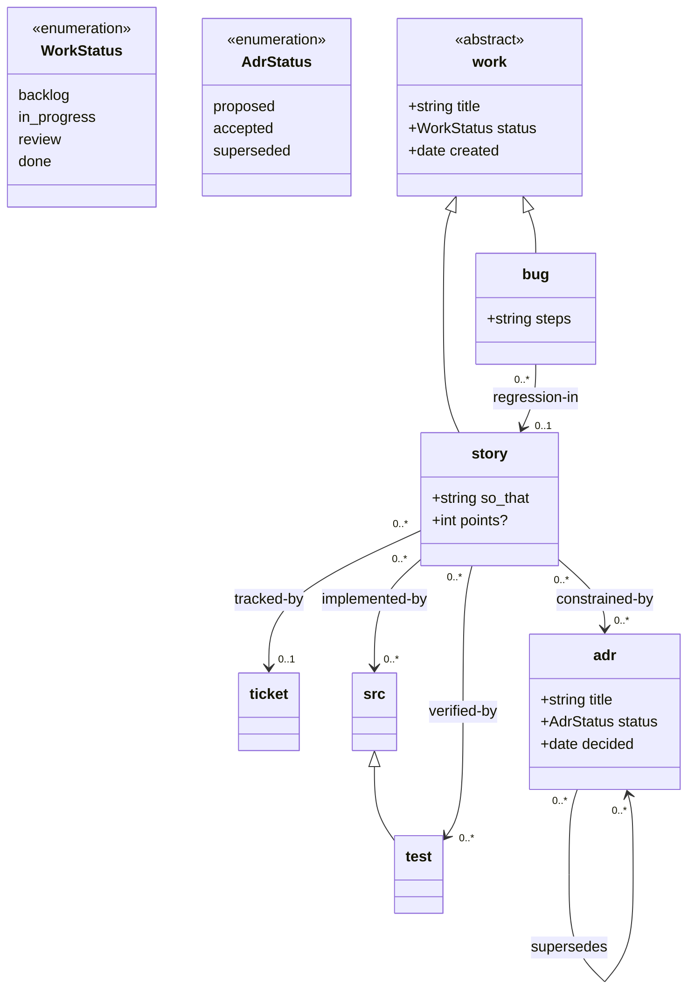
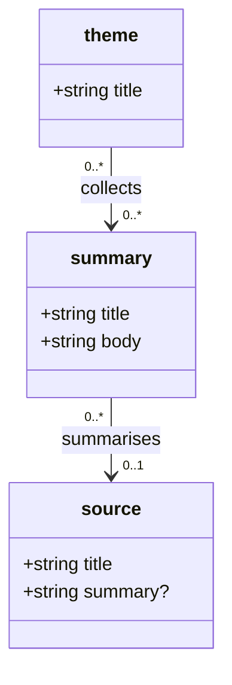

# Example Loom Workflows

Three concrete, validated reference workflows showing how to design a Mermaid document model, configure paths and indexes, and write the companion agent skill that puts it into practice.

1. **[Agile Feature Flow](#1-agile-feature-flow)**: Traceable software development linking user stories, ADRs, source code anchors, and test anchors.
2. **[Getting Things Done (GTD)](#2-getting-things-done-gtd)**: Personal productivity system with inbox capture, projects, next actions with contexts, and review routines.
3. **[Local Knowledge Base](#3-local-knowledge-base-obsidian-style)**: Obsidian-style research vault — sources flow in, summaries distil them, themes organise the summaries; the inbox is a view, not a list.

---

# 1. Agile Feature Flow

A lightweight software development workflow for feature tracking and architecture decision records with end-to-end traceability to code and tests.

- **Design root**: `design/` (default)
- **Code root**: `/src`
- **Test root**: `/test`

## Mermaid Model (`design/document-model.mmd`)



### Key Model Decisions
- `work` is an abstract parent defining shared fields (`title`, `status`, `created`). Subclasses inherit them automatically.
- `src` is Loom's built-in terminal anchor family for source code. Subclassing `src <|-- test` creates a `test:` scheme; it would nest at `src/test` by default, so the explicit `%% @prefix test: <repo:test/> .` points it at `/test`.
- Code and tests are referenced down to symbol level via anchors: `src:auth.ts#login`, `test:auth.test.ts#testLogin`.
- `story` points to `adr` via `constrained-by`, giving architectural context to feature implementation.
- `ticket:` is an external prefix (a GitHub issue tracker), so a story can link
  to an upstream issue without creating a file.

## Companion Skill (`skills/feature-workflow/SKILL.md`)

```markdown
---
name: feature-workflow
description: Procedures and rules for picking up, developing, and completing features in this repository using Loom.
---

# Feature Workflow

Use this skill when picking up stories, recording architecture decisions, writing code, and completing tasks.

## 1. Pick Up Work

Find the next backlog or in-progress story:

```bash
loom query "SELECT uri, title, points FROM story WHERE status = 'backlog' ORDER BY points ASC"
```

To take on a story, update its status:

```bash
loom set story:my-feature.md status=in_progress
```

## 2. Record Architecture Decisions

When a story requires significant design or pattern changes, record an ADR:

```bash
loom create adr:use-redis-cache.md title="Use Redis Cache" status=accepted decided=$(date +%Y-%m-%d)
loom body set adr:use-redis-cache.md "## Context\n\nHigh load on DB.\n\n## Decision\n\nCache user sessions in Redis."
loom link story:my-feature.md constrained-by adr:use-redis-cache.md
```

If the story also tracks an upstream GitHub issue, link to it with the
external prefix — no file is created, `validate` just skips the filesystem
check:

```bash
loom link story:my-feature.md tracked-by ticket:417
```

## 3. Implement and Link Code & Tests

When implementing, link the story to the relevant source symbols and test cases:

```bash
loom link story:my-feature.md implemented-by src:cache/redis.ts#SessionCache
loom link story:my-feature.md verified-by test:cache/redis.test.ts#testSessionExpiry
```

Loom automatically checks that `#SessionCache` and `#testSessionExpiry` exist in the AST of those files.

## 4. Check Traceability & Validate

Before finishing work, verify that the graph is coherent:

```bash
# Stories in progress missing tests:
loom query "SELECT s.uri, s.title FROM story s WHERE s.status = 'in_progress' AND NOT EXISTS (SELECT 1 FROM edge e WHERE e.subject = s.uri AND e.relation = 'verified-by')"

# Full repo validation:
loom validate
```

## 5. Complete the Story

Update status to done and regenerate the index board:

```bash
loom set story:my-feature.md status=done
loom index
```
```

---

# 2. Getting Things Done (GTD)

A complete personal productivity system based on David Allen's Getting Things Done (GTD) methodology, tracking inbox capture, active projects, next actions organized by physical context, and review cycles.

- **Design root**: `gtd/` (configured via `.loom.yaml` with `designRoot: gtd`)
- **Attachments root**: `gtd/files/`

## Configuration (`.loom.yaml`)

```yaml
designRoot: gtd
```

## Mermaid Model (`gtd/document-model.mmd`)

```mermaid
classDiagram
    %% @prefix resource: <repo:gtd/files/> .
    class ActionStatus {
        <<enumeration>>
        next
        waiting
        scheduled
        someday
        done
    }

    class ProjectStatus {
        <<enumeration>>
        active
        on_hold
        complete
        dropped
    }

    class Context {
        <<enumeration>>
        home
        office
        computer
        phone
        errands
        anywhere
    }

    class inbox {
        +string title
        +date captured
    }

    class area {
        +string title
        +string purpose
    }

    class project {
        +string title
        +string outcome
        +ProjectStatus status
        +date review_due?
    }

    class action {
        +string title
        +ActionStatus status
        +Context context
        +date due?
        +string waiting_on?
        +int minutes?
    }

    class note {
        +string title
        +date captured
    }

    class review {
        +string title
        +date performed
    }

    %% @prefix bookmark: <https://example.com/bookmarks/> .

    project "0..*" --> "0..1" area : supports
    action "0..*" --> "0..1" project : advances
    action "0..*" --> "0..*" action : blocks
    note "0..*" --> "0..*" project : relates-to
    note "0..*" --> "0..*" resource : attachment
    review "0..*" --> "0..*" project : reviewed
```

### Key Model Decisions
- `inbox` is an unclarified capture bucket with minimal metadata (`title`, `captured`).
- `action` is classified by `ActionStatus` (`next`, `waiting`, `scheduled`, `someday`, `done`) and physical `Context` (`home`, `office`, `computer`, `phone`, `errands`, `anywhere`).
- `project` has an explicit desired `outcome` and belongs to an `area` of responsibility.
- `action "0..*" --> "0..1" project : advances` allows standalone actions (actions that do not belong to a multi-step project).
- `%% @prefix bookmark: <https://example.com/bookmarks/> .` lets notes link to web
  bookmarks by curie (`bookmark:looming`) — no local file needed, and
  `validate` skips the filesystem check for external targets.
- DuckDB queries easily find stalled projects (active projects with no pending `next` action).

## Dynamic Views (`gtd/NEXT.md`, `gtd/PROJECTS.md`)

Declare the queries in the model, then let `loom render` fill the boards:

```markdown
# Next Actions

<!-- loom view: next_actions -->
```

```mermaid
    %% @view next_actions
    %% SELECT uri, title, context FROM action
    %% WHERE status = 'next'
    %% ORDER BY context, title
```

## Companion Skill (`skills/gtd-workflow/SKILL.md`)

```markdown
---
name: gtd-workflow
description: Procedures for managing tasks, inbox processing, weekly reviews, and project tracking with Loom.
---

# GTD Workflow

Use this skill when capturing thoughts, clarifying inbox items, choosing what to do next, or performing a weekly review.

## 1. Quick Capture to Inbox

Capture any idea, task, or commitment immediately without friction:

```bash
loom create inbox:boiler-service.md title="Boiler service notice received" captured=$(date +%Y-%m-%d)
loom body set inbox:boiler-service.md "Letter from British Gas arrived today with annual service reminder."
```

## 2. Clarify & Process the Inbox

Process inbox items into actionable next actions or multi-step projects. Use changesets to create the action and remove the inbox item atomically:

```yaml
# clarify-boiler.yaml
ops:
  - op: create
    uri: action:call-boiler-service.md
    attrs:
      title: "Call British Gas to book annual service"
      status: next
      context: phone
      minutes: 10
  - op: delete
    uri: inbox:boiler-service.md
```

```bash
loom apply clarify-boiler.yaml
```

To attach a web reference to a note, use the external prefix directly:

```bash
loom link note:boiler-notice.md attachment bookmark:boiler-manual
```

If it represents a multi-step outcome, create a `project` and link the initial next action to it:

```bash
loom create project:fix-boiler.md title="Service and certify boiler" outcome="Boiler serviced and signed off" status=active
loom link project:fix-boiler.md supports area:home.md
loom link action:call-boiler-service.md advances project:fix-boiler.md
```

## 3. Working by Context

When ready to take action, query tasks matching your current location or energy:

```bash
# Actions I can do on my phone in 15 minutes or less:
loom query "SELECT uri, title, minutes FROM action WHERE status = 'next' AND context = 'phone' AND minutes <= 15"

# What am I waiting on others for?
loom query "SELECT waiting_on, title FROM action WHERE status = 'waiting' ORDER BY waiting_on"
```

Mark an action done:

```bash
loom set action:call-boiler-service.md status=done
```

## 4. Weekly Review Routine

Run queries to find stalled projects and overdue items:

```bash
# 1. Stalled projects: active projects with no 'next' action advancing them
loom query "SELECT p.uri, p.title FROM project p WHERE p.status = 'active' AND NOT EXISTS (SELECT 1 FROM edge e JOIN action a ON a.uri = e.subject WHERE e.relation = 'advances' AND e.object = p.uri AND a.status = 'next')"

# 2. Overdue actions:
loom query "SELECT uri, title, due FROM action WHERE status = 'next' AND due < CURRENT_DATE"

# 3. Record the completed review:
loom create review:review-$(date +%Y-W%W).md title="Weekly Review $(date +%Y-W%W)" performed=$(date +%Y-%m-%d)
loom index
```
```

---

# 3. Local Knowledge Base (Obsidian-style)

A research vault with sources flowing in continuously, summaries distilling them, and themes organising the summaries. Designed for an Obsidian-style folder layout (`kb/sources/`, `kb/summaries/`, `kb/themes/`) — loom never touches Obsidian's `.obsidian/` config, and Obsidian is happy to open the same files.

The core pattern: **inputs arrive as sources with no summary; the pending-work view is "sources whose `summary` attribute is still empty"; a summary links back to its source; themes link the summaries together.** Processing the inbox means summarising a source — the attribute fills in and the item disappears from the board on its own.

## Configuration (`.loom.yaml`)

```yaml
designRoot: kb
```

## Mermaid Model (`kb/document-model.mmd`)



### Key Model Decisions
- `source` is anything that arrives: web clippings, meeting notes, papers. Its `summary?` attribute is **empty until processed** — an optional attribute that is absent from the frontmatter reads as SQL `NULL`, which is what makes the unsummarised view a one-liner.
- `summary` is a *document*, not an attribute string, when the distillation needs to be a page in its own right (backlinks, its own links to themes). The `summarises` edge ties it to exactly one source.
- `theme` collects summaries. Themes with zero summaries still show up — that is the signal to go reading.
- External material (web pages, videos) can live behind an external prefix instead: `%% @prefix web: <https://example.com/reading/> .` — see Appendix B of the creating skill.

## Dynamic Views (`kb/INBOX.md`, `kb/THEMES.md`)

```markdown
# Unsummarised sources

<!-- loom view: SELECT uri, title FROM source WHERE summary IS NULL ORDER BY uri -->
```

```markdown
# Themes

<!-- loom view: SELECT t.title, count(e.object) AS n FROM theme t LEFT JOIN edge e ON e.subject = t.uri AND e.relation = 'collects' GROUP BY t.title ORDER BY t.title -->
```

`loom render` fills both. The inbox list shrinks as summaries are written; the theme table grows as `collects` links are added.

## Working the Vault

```bash
# What is waiting to be summarised: the inbox view above, or directly
loom query "SELECT uri, title FROM source WHERE summary IS NULL"

# Process one source: write a summary page and link it back
loom create summary:article-embeddings.md title="Embeddings article" body="What the article claims is..."
loom link summary:article-embeddings.md summarises source:clippings/article.md

# File a summary under a theme
loom link theme:embeddings.md collects summary:article-embeddings.md

# Sources still missing a summary after a link was made? Just re-render.
loom render
```

## Companion Skill

A `kb-workflow` skill follows the same shape as the two above: capture (append to `source:`), process (create `summary:` + link), curate (link `theme:` → `summary:`), weekly review (render the boards, check for themes with `n = 0`).
