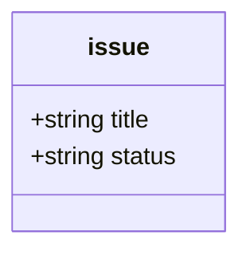

## Migration Guide: `view:` frontmatter → `%% @view` annotations

Before inline views, index files used a `view:` field in YAML frontmatter and
`<!-- loom:links ... -->` markers that `loom index` filled with auto-generated
link blocks. The new `%% @view` + `<!-- loom view: ... -->` approach is more
flexible — any file, with parameters, inline SQL — and the old approach
remains supported. This guide helps you migrate one index file at a time.

### Old format (still works)

**Model** (no view annotations):


**Index file** (`issues/INDEX.md`):
```markdown
---
class: index
title: Open Issues
view:
  class: issue
  where:
    status: open
  orderBy: created DESC
---

# Open Issues

<!-- loom:links start -->
<!-- loom:links end -->
```

### SQL Query View Example (`$LOOM_DEFAULT_ROOT/adrs/INDEX.md`)
```markdown
---
class: index
title: Architecture Decision Records
view:
  query: "SELECT uri, title FROM adr ORDER BY accepted_date DESC"
---

# Architecture Decisions

<!-- loom:links start -->
<!-- loom:links end -->
```

Processed by: `loom index` → generates link block. Works forever.

### New format (recommended for new files, migrate when convenient)

**Model** (add `%% @view`):


**Index file** (`issues/INDEX.md`) — drop the `view:` frontmatter, replace
`<!-- loom:links -->` markers with `<!-- loom view: -->`:
```markdown
---
class: index
title: Open Issues
---

# Open Issues

<!-- loom view: open_issues -->
<!-- loom view: open_issues end -->
```

Processed by: `loom render` → replaces the span with a table. Mark old
`class: index` as a data-only annotation — the file is no longer special
to `loom index` (but keeping `class: index` does not break anything).

### When to `loom render` vs `loom index`

| Feature | `loom index` | `loom render` |
|---|---|---|
| Managed link blocks | Yes | No |
| Editable prose | No | No (read-only output) |
| Inline in any document | No | Yes |
| Parameters per invocation | No | Yes (`?key=val`) |
| CI check | `--check` | `--check` |

`render` can do everything `index` can do and more. The only reason to not use 
it is if you want the query and the result in the same file.

### Step-by-step recipe

1. Add a `%% @view <name>` annotation to `document-model.mmd` with the SQL
   query that matches what the old `view:` block was doing.
2. Verify the query works: `loom rebuild && loom query "<your SQL>"`.
3. Open the index file, remove the `view:` key from frontmatter (leave
   `class: index` — harmless), and replace the `<!-- loom:links start -->`
   / `<!-- loom:links end -->` pair with `<!-- loom view: <name> -->`
   (the end marker is inserted by `loom render`).
4. Run `loom render` to fill in the table.
5. Delete the old generated content between the markers — `loom render`
   replaces it anyway, but the file is cleaner to read before CI runs.
6. Run `loom validate` and `loom index --check` to confirm nothing is
   broken. Both commands coexist with `loom render`.

### What stays the same

- The **`class: index`** frontmatter field is purely informational — it does
  not conflict with `loom render` and does not need to be removed.
- **`loom index`** still works. Mix old-style and new-style index files in the
  same repository.
- **Validation and CI** still use `loom validate` and `loom index --check`;
  add `loom render --check` to catch stale view markers.

### When not to migrate

- If the index file is purely a navigational listing of instances with no
  custom SQL, the old `view:
    class: issue
    where:
      status: open`
  syntax is simpler to write and there is no benefit to rewriting it.
- If the index file is rarely opened or exists only for machine consumption,
  leave it alone.
