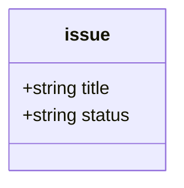

# Using the Loom CLI

`loom` treats Markdown files in a repository as typed instances in a graph governed by a Mermaid class diagram (`document-model.mmd`). This skill covers CLI installation, invocation rules, common operations, and error recovery.

`loom` will generally auto detect the Mermaid class diagram location and base
the root of its documentation in the parent directory. `$LOOM_DEFAULT_ROOT` can 
be explicitly set to skip that detection. `repo:` means the git root unless
`$LOOM_REPO_ROOT` overrides it (e.g. one loom per monorepo package).

## 1. Installation & Environment

### Project Installation
In projects with `loom` in `devDependencies`:
```bash
npm install
npx loom --help
```

### Global or Standalone Link
To build and link into another local project:
```bash
cd /path/to/loom
npm run build
bun link          # or npm link

# In your target project:
bun link loom     # or npm link loom

# or run directly without linking:
node /path/to/loom/dist/cli.js --help
# or run directly from TypeScript (no build needed):
bun /path/to/loom/src/cli.ts --help
```

### Language Parser Prefetch
`loom` uses Tree-Sitter grammars for code parsing and anchor resolution. Grammars download **lazily**, on the first parse of a file in that language, so normally you need do nothing.

On offline or sandboxed setups that lazy download fails, so warm the cache first by naming the languages the repository contains. At least one language is required — there is no default set:
```bash
loom prefetch typescript python r
```

## 2. Invocation Rules & Output Formats

### Global Options Placement
Global options **must precede** the subcommand name:
```bash
loom --json resolve issue:a.md     # Correct
loom resolve issue:a.md --json     # Error: unrecognized option
```

- `--json`: Output machine-readable JSON instead of human-friendly YAML.
- `--cwd <path>`: Run as if invoked from `<path>` (defaults to `process.cwd()`). Repository root is discovered via git.
- `-v, --version`: Print the installed loom version and exit. Needs no model, config or git repository — use it to confirm which build is on `PATH`.

### Always Address Documents by URI, Never by Path

Every `<uri>` argument takes a design URI, **not** the file path you can see on
disk. The path is just where the class root happens to point; the URI is the
address.

```bash
loom show issue:fix-login.md          # Correct
loom show design/issue/fix-login.md     # Error: uri/bare-path
```

If you pass a path, loom refuses it and tells you the URI to use:

```
uri/bare-path: "design/issue/fix-login.md" is a filesystem path, not a design uri
  fix: use issue:fix-login.md instead
```

Copy the suggested URI and re-run. The same rule applies to URIs written into
frontmatter relations (`blocks: [issue:b.md]`) and to `ops` in a changeset
file. To go the other way — from a path you already have to its URI — the error
itself is the quickest answer, and `loom ls <class>:` lists what exists.

### Output Contracts
Every command produces one of three shapes:
1. **Data** (exit 0): structured payload on stdout.
2. **Report** (exit 0 or 1): carries `{ ok: boolean, errors: n, warnings: m, diagnostics: [...] }`.
3. **Error** (exit 1 or 2): message on stderr when aborted before report assembly.

## 3. Core Commands & Workflows

### Validating the Graph
```bash
# Validate entire graph
loom validate

# Automatically repair unambiguous issues (stale link blocks, non-canonical URIs, git renames)
loom validate --fix

# Dry-run validation against a proposed model
loom validate --model proposed-model.mmd

# Check model definition syntax and invariants
loom model check
```

### Navigating & Inspecting Instances
```bash
# Resolve URI to disk path or source line number
loom resolve issue:fix-login.md
loom resolve src:auth.ts#login

# Inspect instance YAML frontmatter + markdown body (verbatim, as on disk)
loom show issue:fix-login.md

# Read just the editable prose, with relative links shown as design uris
loom --json body get issue:fix-login.md

# Hierarchical directory and symbol exploration (ls)
loom ls issue:                       # List all instances of class 'issue'
loom ls src:                         # List files in source directory (src: is wherever the model's `%% @prefix src:` points)
loom ls src:auth.ts                  # List linkable symbols/anchors in file
loom ls src:auth.ts --kind Method   # Filter symbols by kind

# Recursive discovery over the whole tree (find) — unlimited depth by default
loom find src:                        # Dirs, files and every anchor, sorted
loom find src: --depth 1              # One level down, like ls
loom find src:app.ts --depth 2        # Top-level anchors and their children
loom find src: --kind Method          # Methods only (dirs/files filtered out)
loom find src: --unlinked             # Everything no design doc links to yet

# Locate which symbol encloses a specific line in source
loom locate src:auth.ts --line 42

# Find which design documents link to a given source symbol
loom refs src:auth.ts#login

# Semantic similarity search across markdown bodies
loom similar "authentication token expiration" --limit 5
loom similar issue:fix-login.md
```

### Creating & Mutating Documents

All mutations validate the whole graph in memory before writing anything to disk.

#### Single-Operation Sugar
```bash
# Create an instance
loom create issue:new-feature.md "title: Support Passkeys" "status: open"

# Update scalar attributes or relations
loom set issue:new-feature.md status in_progress

# Link two design documents
loom link issue:new-feature.md blocks issue:old-feature.md

# Link source code to a document (writes comment inside function body!)
loom link src:auth.ts#login implements issue:new-feature.md
# Or link source code targeting an anchor from a line number:
loom link src:auth.ts --line 42 implements issue:new-feature.md

# Remove link
loom unlink issue:new-feature.md blocks issue:old-feature.md
loom unlink src:auth.ts#login implements issue:new-feature.md

# Rename an instance (updates all inbound URIs across the corpus)
loom rename issue:old-name.md issue:new-name.md

# Delete an instance (fails if inbound relations still exist)
loom delete issue:old-name.md
```

#### Editing the Markdown Body

Edit prose through `loom`, not with a file editor: the body commands cannot
touch the YAML frontmatter or the protected `<!-- loom:links -->` block, so
there is no way to corrupt either.

```bash
# Read the prose (frontmatter and link block excluded)
loom --json body get issue:fix-login.md

# Replace it (inline or from a file to avoid shell-escaping headaches)
loom body set issue:fix-login.md "## Cause

Session cookie expires early.
"
loom body set issue:fix-login.md --file /tmp/new-body.md

# Add to the end of it
loom body append issue:fix-login.md "
## Update

Fixed in 1.2.1.
"
loom body append issue:fix-login.md --file /tmp/update.md

# Apply a unified diff to it
loom body patch issue:fix-login.md "@@ -1,3 +1,3 @@
 ## Cause
-Session cookie expires early.
+Session cookie expired one hour early.
"
loom body patch issue:fix-login.md --file /tmp/fix.diff

# Any of the three can be previewed
loom body set issue:fix-login.md "New prose.
" --dry-run
loom body set issue:fix-login.md --file /tmp/new-body.md --dry-run
```

**Links are translated in both directions.** Write design URIs; loom converts
them to relative markdown links on disk, so the file renders correctly on
GitHub. Read them back and they are URIs again:

```bash
loom body set issue:a.md "Caused by [the auth ADR](adr:auth.md).
"
# on disk:  Caused by [the auth ADR](../adr/auth.md).
# body get: Caused by [the auth ADR](adr:auth.md).
```

URLs, `mailto:`, in-page `#fragments` and paths outside the repository are left
alone. A `patch` whose context does not match fails with `body/patch-failed`
and writes nothing — re-read with `body get` and rebuild the diff.

#### Batch Mutations (Changesets)
For multi-step or multi-file mutations:
```bash
# Preview diff without touching disk
loom apply changes.yaml --dry-run

# Commit changeset atomically
loom apply changes.yaml
```

*Example `changes.yaml`:*
```yaml
- op: create
  uri: issue:passkeys.md
  data:
    title: Support Passkeys
    status: open
- op: link
  from: issue:passkeys.md
  rel: relates-to
  to: issue:auth.md
```

### Navigational Indexes
Human-navigable indexes are generated into markdown files declaring `class: index`.
```bash
# Rebuild all index link blocks
loom index

# Verify indexes in CI (exits 1 if any index is stale)
loom index --check
```

### Inline Views (Live Query Results in Any Markdown File)

Scans every `.md` file in the repo for `<!-- loom view: ... -->` markers and
replaces the content between the marker and its matching end marker with live
data from the DuckDB graph. End markers are qualified — `<!-- loom view: <name>
end -->` — so several views can share one page; a bare `<!-- loom view: end -->`
is still accepted. A missing end marker is fine: the section is empty and
`loom render` inserts the content and the qualified end right after the
marker — prose below is never touched.

```bash
# Render all view markers in every .md file
loom render

# Dry-run for CI (exits 1 if any marker would change)
loom render --check

# Print resolved SQL for each view to stderr
loom render --debug
```

#### Named views (defined in the model)

In `document-model.mmd`, declare SQL queries with `%% @view <name>`:



Then use the name in any markdown file:

```markdown
## Open Issues

<!-- loom view: open_issues -->
<!-- loom view: open_issues end -->
```

#### Inline SQL (no model definition needed)

```markdown
<!-- loom view: SELECT count(*) AS cnt FROM issue -->
<!-- loom view: end -->
```

#### Parameters

Pass parameters via query-string syntax in the marker; the view definition
references them with `$name`:

```markdown
<!-- loom view: open_issues?status=in_progress&limit=5 -->
```

```mermaid
    %% @view open_issues
    %% SELECT uri, title, status
    %% FROM issue
    %% WHERE status = '$status'
    %% LIMIT $limit
```

**List parameters** use comma-separated values (backslash-escaped commas are
literal): `status=open,in_progress` expands to `status IN ('open', 'in_progress')`.

#### Output rules

| Rows | Columns | Rendered as |
|---|---|---|
| 0 | any | `_(no results)_` |
| 1+ | 1 | bullet list (`- value`) |
| 1+ | 2–4 | markdown table |
| 1+ | 5+ | compact bold-key list (`**col:** val  **col2:** val2`) |
| error | any | `_Query failed: <message>_` |

An unknown view name is a `render/unknown-view` **error** (exit 1, nothing
written), not a row. Markers inside fenced code blocks or inline code spans
are ignored — safe to document the syntax. Files under `node_modules`,
dot-directories, or matched by `.gitignore` are never touched.

**URI cells become links.** A cell holding a design uri that resolves to an
existing file renders as `[<title>](<relative path>)` — the document title
when the uri names an indexed instance, the uri text otherwise. Values that
do not resolve (missing files, non-uris) stay plain text.

`render` automatically rebuilds the DuckDB database if it does not exist.

### Querying with SQL (DuckDB)
The graph and relations project into DuckDB:
```bash
# Rebuild the projection database
# (design/.loom/db/<branch>/loom.duckdb — one per git branch)
loom rebuild

# Query concrete class tables or edge triples
loom query "SELECT uri, title, status FROM issue WHERE status = 'open'"
loom query "SELECT subject, relation, object FROM edge WHERE relation = 'blocks'"
```

#### Class-typed attributes project as STRUCTs
Nested values (e.g. `reporter: { name, email }`) become DuckDB `STRUCT(...)`
columns (lists become `STRUCT(...)[]`). Subfields are queryable without
casts and misspellings fail loudly with a Binder Error — the preferred
behaviour over JSON columns.

```sql
-- direct subfield access
SELECT reporter.name, reporter.address.city FROM issue;

-- aggregate over a list of structs
SELECT u.name FROM issue, UNNEST(reviewers) u;

-- DESCRIBE reveals the nested schema so an agent can discover it
DESCRIBE issue;
```

#### Enumerations are native ENUM types
An `<<enumeration>>` projects as a DuckDB `ENUM` declared in the model's member
order, so ordering follows the lifecycle rather than the alphabet:

```sql
-- model order: backlog, in_progress, review, done
SELECT title, status FROM story ORDER BY status;      -- backlog first
SELECT MIN(status), MAX(status) FROM story;           -- earliest, latest stage
SELECT list_sort(stages_seen) FROM story;             -- also declaration order
```

- **Equality and `ORDER BY` need no cast.** An *ordering* comparison against a
  bare literal does: DuckDB reads `status > 'backlog'` by casting the enum down
  to text (alphabetical). Write `status > 'backlog'::WorkStatus` instead.
- **Run `loom rebuild` after editing an enumeration's members** — the type is
  baked into the database.
- A value outside the enumeration reads back as `NULL`; run `loom validate` to
  find which file is wrong.

#### Semantic search across markdown bodies
The rebuild also populates an `embedding` table (one vector per
instance). Search with `loom similar`:
```bash
loom similar "authentication token expiration" --limit 5
loom similar issue:fix-login.md
```

## 4. Troubleshooting Common Diagnostics

| Diagnostic Code | Meaning | Recovery / Fix |
|---|---|---|
| `uri/bare-path` | A filesystem path was given where a design URI belongs (e.g. `design/issue/a.md` instead of `issue:a.md`). | Use the URI named in the diagnostic's `fix`. Nothing was written. |
| `uri/malformed` | The argument is not a URI at all (e.g. `://no-scheme`). | Write it as `<class>:<id>`, e.g. `issue:a.md`. |
| `graph/stale-links` | Protected link block in markdown is out of sync with frontmatter. | Run `loom validate --fix`. |
| `graph/non-canonical-uri` | A URI has unnecessary path segments or wrong format. | Run `loom validate --fix`. |
| `graph/renamed-symbol` | Source symbol anchor broken, but matches a renamed symbol since `HEAD`. | Run `loom validate --fix` to rewrite. |
| `graph/missing-symbol` | Source anchor `#symbol` not found in file. | Use `loom ls src:path` or suggestion in diagnostic `fix` to correct name. |
| `graph/missing-source-file` | Target file in `src:` URI does not exist. | Check file path or remove link. |
| `graph/dangling-link` | Referenced design URI does not exist. | Create missing document or remove edge. |
| `graph/inbound-cardinality` | A required relation is missing or exceeds cardinality (e.g. `1`, `0..1`). | Adjust edges with `link` or `unlink`. |
| `source/ambiguous-anchor` | Symbol name appears multiple times in file (e.g. nested scope or overload). | Use fully-qualified anchor path (e.g. `Class.method` or `func(int,string)`). |
| `source/not-annotatable` | Attempted to link source declaration that lacks a block body (e.g. interface signature). | Attach comment to the enclosing class or linking document instead. |
| `source/verification-failed` | Splicing comment into source caused syntax error or attached to wrong AST node. | Check source file syntax; annotate manually if needed. |
| `body/patch-failed` | A `loom body patch` hunk matched no part of the prose (or the patch had no `@@` hunks). | Re-read with `loom --json body get` and rebuild the diff against that text. Nothing was written. |
| `query/enum-type` | An `<<enumeration>>` class is named after a built-in database type (`date`, `blob`, ...). | Rename the enumeration in the model, then `loom rebuild`. |
